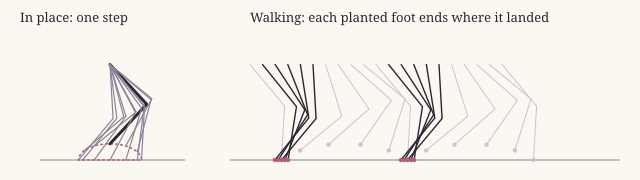
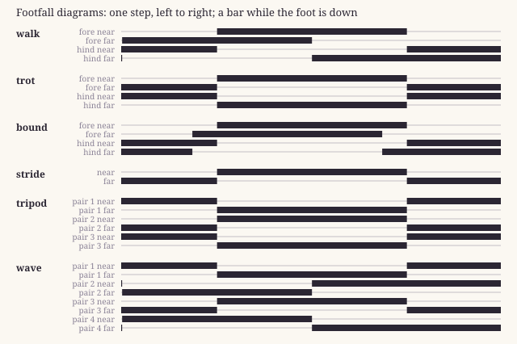
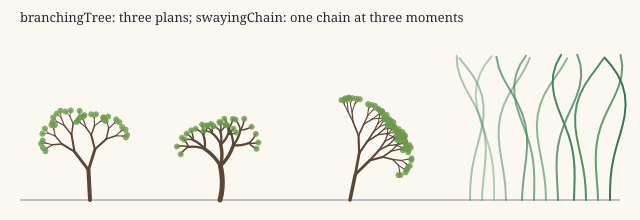
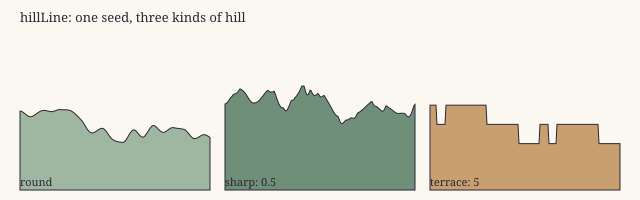

# The catalog

*Written from [almanac.json](almanac.json) and [references.json](references.json) by `npm run docs`: edit those, not this.*

Each entry is one function or class. **Established techniques** are someone else’s work, and cite it: an *intro* to start from (often an encyclopedia article) and the *source* it comes from (a paper, a book, a standard, published code). **Originals** are this almanac’s own, and since there is nothing to cite, they explain themselves: what they are for, what inspired them, what they build on, and how they work in plain words. Every entry lists its tests, each one a sentence saying what it checks; the test run fails if a sentence here is not a real check.

| entry | kind | what it does |
|---|---|---|
| [hash32](#hash32) | established | one 32-bit integer, well mixed: inputs one bit apart give outputs about half their bits apart |
| [fnv1a](#fnv1a) | established | a string as a 32-bit number: each character mixed in with an exclusive or, then a multiplication |
| [hashString](#hashstring) | established | a string as a well-mixed 32-bit number: FNV-1a, then hash32 over it |
| [SeededRandom](#seededrandom) | established | numbers in [0, 1) from a seed: the same seed, the same sequence; with ranges, whole numbers, chances, signs and picks |
| [twoBoneLimb](#twobonelimb) | established | a limb of two bones reaching for a point: where its middle joint goes so its tip lands on the point |
| [gaitTiming](#gaittiming) | established | which legs step together in a gait: the phase of each leg, pair by pair, front to back |
| [clamp](#clamp) | established | a number kept inside a range |
| [lerp](#lerp) | established | part of the way from one number to another, in a straight line |
| [smoothstep](#smoothstep) | established | where a number is between two edges, eased so it starts and ends level |
| [wrap](#wrap) | established | a number wrapped round a span, never negative: what scrolls off one side comes back on the other |
| [latticeRandom](#latticerandom) | established | a number in [0, 1) for each point of a grid and a seed: the random values value noise blends |
| [valueNoise](#valuenoise) | established | smooth noise in 0..1 across the plane: a random number at each grid point, blended between them |
| [fractalNoise](#fractalnoise) | established | noise with detail at every size: value noise at several scales, each finer one fainter |
| [ridgedNoise](#ridgednoise) | established | noise whose highs are thin sharp lines: each scale of fractal noise folded at its middle |
| [noiseLine](#noiseline) | established | value noise along a line: a number in 0..1 that wanders smoothly as x moves |
| [hexToRgb](#hextorgb) | established | a "#rrggbb" or "#rgb" colour as [red, green, blue] |
| [rgbToHex](#rgbtohex) | established | [red, green, blue] as "#rrggbb", rounded and kept in range |
| [rgba](#rgba) | established | [red, green, blue] and an opacity as a CSS colour for a canvas |
| [mixColour](#mixcolour) | established | part of the way from one colour to another, channel by channel |
| [shade](#shade) | established | a colour darkened toward black or lightened toward white |
| [luma](#luma) | established | how bright a colour looks, 0..1, weighing green most and blue least as the eye does |
| [rgbToHsl](#rgbtohsl) | established | a colour as hue, saturation and lightness: the colour wheel's terms |
| [hslToRgb](#hsltorgb) | established | hue, saturation and lightness back to [red, green, blue] |
| [aerialPerspective](#aerialperspective) | established | a colour as the day shows it at a distance: faded toward the horizon the further it is, and dimmed after dark |
| [parallax](#parallax) | established | how far a layer scrolls when the camera moves: in proportion to how near it is |
| [turnedProjection](#turnedprojection) | established | a point of a turning grid to the screen: turned round the centre, tipped back to half its depth, lifted by its height |
| [turnedDepth](#turneddepth) | established | how far back a point of a turning grid is: draw the farthest first, so the near is painted over the far |
| [flockStep](#flockstep) | established | a flock or a school a moment later: each one steers to the centre and the average heading, away from any too close, and away from a hunter |
| [gridWalk](#gridwalk) | established | a walker on a grid a moment later: toward the middle of its next tile, and on arriving, a random allowed neighbour next, sometimes after a pause |
| [particleField](#particlefield) | established | many small things strewn at random over a field, each with a depth, a phase and a number of its own |
| [branchingTree](#branchingtree) | established | a branching thing (a tree, a coral, a crystal antler): a trunk that forks, each branch shorter and thinner, to the tips |
| [stampCache](#stampcache) | established | a cache of things drawn once and stamped many times, forgetting the oldest past its limit |
| [grain](#grain) | established | grain over a whole picture (paper, film): a fixed texture of fine noise laid over everything by a blend mode |
| [vignette](#vignette) | established | the picture darkened toward its edges and corners, its middle left clear |
| [mirrorBelow](#mirrorbelow) | established | a mirror of what is already drawn above a line, laid below it, fading and rippling (a wet street, a still lake) |
| [drawList](#drawlist) | established | draws a display list: a drawing given as data (shapes with their fills and strokes, and groups that move, blend or shade them) |
| [latticeHash](#latticehash) | established | one well-mixed 32-bit number for a point of a grid and a seed: the whole number latticeRandom divides into [0, 1) |
| [linearCongruential](#linearcongruential) | established | a seeded stream of numbers in [0, 1), each the last times a constant plus a constant, kept to 32 bits (Numerical Recipes' constants) |
| [angleDiff](#anglediff) | established | the signed turn from one angle to another the short way round, between -pi and pi, however many times round either has gone |
| [noiseTile](#noisetile) | established | a square of value noise that tiles: its right edge meets its left and its bottom its top, so it can be scrolled for ever |
| [packRgb](#packrgb) | established | a colour as one 32-bit number the way an ImageData keeps a pixel when its bytes are read as a Uint32Array: 0xAABBGGRR, opaque |
| [mixPacked](#mixpacked) | established | two packed colours mixed, red, green and blue each a share of the way from one to the other |
| [packedHsl](#packedhsl) | established | a packed colour from hue (degrees), saturation and lightness |
| [packedToHsl](#packedtohsl) | established | a packed colour's hue (degrees), saturation and lightness |
| [bayerThreshold](#bayerthreshold) | established | the ordered-dithering threshold at a pixel: the 4 x 4 Bayer matrix repeated across the picture, as a number in 0..1 |
| [heightWater](#heightwater) | established | what a height of the land makes it by the rule lower is water, higher is ground: water as deep as it is low, a shore just above |
| [ellipseRows](#ellipserows) | established | the rows a filled ellipse covers, each a run of whole pixels: the half-width at each row from the ellipse's equation, rounded inward |
| [fillEllipse](#fillellipse) | established | a filled ellipse in one colour in a pixel buffer, row by row, clipped to the buffer |
| [capsuleSteps](#capsulesteps) | established | a capsule (a line with a thickness at each end, changing evenly) as discs set along it, about one and a half to a pixel of length |
| [lineCells](#linecells) | established | the cells of a line between two pixels, one step at a time with a whole-number error (Bresenham), in every direction |
| [polygonRows](#polygonrows) | established | the rows a filled polygon covers: each row's edge crossings sorted and taken in pairs (the even-odd rule) |
| [ditherEllipse](#ditherellipse) | established | a see-through ellipse without mixing colours: a share of its pixels set in the 4 x 4 ordered-dither pattern |
| [shadeEllipse](#shadeellipse) | established | a shadow: the pixels under an ellipse multiplied darker, a little bluer than redder, the edge a pixel edge |
| [blitSprite](#blitsprite) | established | a sprite stamped into a buffer at its anchor, mirrored if asked, its empty pixels see-through, clipped |
| [blitSway](#blitsway) | established | a sprite stamped with each row shifted sideways by a sway at its height: a shear that bends it without drawing it again |
| [outlinePass](#outlinepass) | established | a line round everything drawn in a buffer: each empty pixel touching a drawn one on a side becomes the line |
| [cutSprite](#cutsprite) | established | a sprite cut out of a buffer: a box copied, with its anchor kept at the same point of the picture |
| [drawnBounds](#drawnbounds) | established | the box round everything drawn in a buffer, or nothing if nothing is |
| [scalePacked](#scalepacked) | established | a packed colour multiplied by a number, each part held at 255: a multiply by a grey |
| [outlineSprite](#outlinesprite) | established | a sprite's pixels with a line round them: every empty pixel touching a drawn one on a side, at the picture's edge too |
| [spriteFromRows](#spritefromrows) | established | a sprite written as rows of letters, one letter a pixel, read through a palette, with room for a line round it |
| [layTemplate](#laytemplate) | established | a template of letters laid onto a grid of letters, its dots see-through, mirrored if asked: a picture built up from parts |
| [gridPixels](#gridpixels) | established | a grid of letters as pixels, each letter read through a palette of packed colours |
| [packSheet](#packsheet) | established | frames of one size packed into a sheet, so many across a row, row after row |
| [dampedSpring](#dampedspring) | established | one step of a damped spring: pulled toward its rest, slowed by damping, the speed updated before the place |
| [waterlineCut](#waterlinecut) | established | half the width of the cut a level surface makes through a round part a height from its middle: the half chord |
| [resampleList](#resamplelist) | established | a list of numbers stretched or squeezed to another length, each new value read in a straight line between the two it falls between |
| [twoBoneLimb3d](#twobonelimb3d) | established | a two-bone limb in three dimensions: where the knee goes for a foot (pulled in to its reach), bent toward a pole and never below the ground |
| [chamferDistance](#chamferdistance) | established | for every cell of a grid not marked zero, how far it is from the nearest that is, a step across costing 3 and a step diagonally 4, in two passes |
| [gridAStar](#gridastar) | established | a shortest way over a grid of open and blocked cells, eight ways, never cutting a corner past a blocked cell, with a budget of cells to look at |
| [segmentClear](#segmentclear) | established | whether a straight line between two points crosses anything: points along it a step apart, each asked whether it is open |
| [straightenPath](#straightenpath) | established | a way of grid points made straight where it can be: a point kept only where the line from the last one kept to the next would cross something |
| [floodFill](#floodfill) | established | everything reachable from a start by steps, each node visited once by its id |
| [untilSettled](#untilsettled) | established | a set grown until it stops growing: a pass over the rules run again for as long as the last one added anything |
| [obliqueShear](#obliqueshear) | established | the matrix of an oblique view looking straight down: vertical edges stay vertical and level lines level while depth runs up and across |
| [obliqueToScreen](#obliquetoscreen) | established | where a point of the ground shows in that oblique view, from the camera's place: across, its offset plus m times its depth; down, its depth less its height |
| [terraceLevel](#terracelevel) | established | how many terraces stand at a point: its height above the water's cut counted in whole steps, from none to the most |
| [footStep](#footstep) | original | where a foot is at a moment of its step: lifted and swinging forward for half of it, planted for the other half |
| [strideRate](#striderate) | original | how far a step's phase turns for each unit the body walks, so a planted foot ends its stance where it landed |
| [genomeFrom](#genomefrom) | original | an individual's genes, drawn from the ranges of its kind: no two alike, each clearly its kind |
| [crossGenomes](#crossgenomes) | original | a child's genes from two parents of one kind: each number mixed between theirs, each choice one parent's, and now and then a gene that mutates, never leaving its kind |
| [indexRandom](#indexrandom) | original | a number in [0, 1) for an index and a seed, the same every time |
| [hueToward](#huetoward) | original | a hue moved part of the way toward another, the short way round; far hues only lean |
| [gradeColour](#gradecolour) | original | a colour graded as a film is graded: a range of hues moved, then the whole picture shifted, saturated, lit, contrasted and warmed |
| [dayCycle](#daycycle) | original | the day at a moment: the sky's colours, how much light there is, where the sun and the moon are |
| [twinkle](#twinkle) | original | how bright a twinkling star is at a moment: a slow swell and fade at its own phase |
| [hillLine](#hillline) | original | the outline of a line of hills, side-on: noise at four scales, sharpened into peaks or stepped into terraces if asked |
| [islandHeight](#islandheight) | original | an island's height at a tile: fractal noise lowered toward the map's edge and lifted toward its middle |
| [scatterAlong](#scatteralong) | original | things scattered along a line: a slot every so often, kept by chance, nudged within it, with a variant and a size |
| [windowLit](#windowlit) | original | whether a window is lit: a fixed share of windows, a pattern that changes every 25 seconds, each building on its own schedule |
| [blink](#blink) | original | whether a blinking light is on: on while a wave at its own rate and phase is above a threshold |
| [faceShade](#faceshade) | original | how much darker a wall is than the ground on top of it, by which way it faces the light |
| [pulseRise](#pulserise) | original | something that rises in pulses (a jelly, a lantern, a spirit) a moment later: pushed up by each pulse, coasting between, swaying |
| [fall](#fall) | original | falling, a moment later (rain, snow, petals, leaves): down at its speed, blown by the wind, fluttering if asked |
| [rise](#rise) | original | rising, a moment later (bubbles, embers): up at its speed, each a little faster or slower, wobbling sideways |
| [hover](#hover) | original | hanging in the air, a moment later (dust, plankton, fireflies): wandering in small loops round where it is |
| [wrapAround](#wraparound) | original | a particle that has left the field comes back on the far side, so the field never thins out |
| [swayingChain](#swayingchain) | original | a chain swaying from a fixed foot (kelp, a vine, a reed, a banner): a wave runs up it, so the foot is still and the tip swings most |
| [setCanvasMaker](#setcanvasmaker) | original | says how canvases are made: in a browser by itself, in Node by the function it is given |
| [makeCanvas](#makecanvas) | original | a new canvas, made the way setCanvasMaker said |
| [partPath](#partpath) | original | the outline of a simple shape (blob, box, spike, tri, gem, dome, stem, disc, ring), standing on a point |
| [fillInArt](#fillinart) | original | fills a shape in an art style: flat, gradient, facet (split hard, like cut stone) or glowing, with a paper shadow and an outline if asked |
| [drawRecipe](#drawrecipe) | original | draws a recipe: a few simple shapes in their colours and the art's style, some repeated and scattered, each repeat a little different |
| [glowSprite](#glowsprite) | original | a small soft glow in a colour, drawn once and kept, to stamp wherever something glows |
| [glowingDisc](#glowingdisc) | original | a glowing disc (the sun, the moon, a lamp): a soft halo four and a half times its size, and the disc |
| [lightRays](#lightrays) | original | light rays from above (sunbeams through cloud, light through water): slanting shafts fading downward, added onto the picture |
| [fogBands](#fogbands) | original | fog lying in a band of the picture: three soft layers, thickest in their middles |
| [puffCloud](#puffcloud) | original | a cloud of six round puffs along a gentle arch, with a soft shadow below and to the right |
| [inkedLine](#inkedline) | original | a line of land inked, the way comics ink it: a dark line, and light hatching under it that travels with the land |
| [tones](#tones) | original | a colour's tones for soft shading: a dark leaning blue-violet, the colour, a light leaning warm cream, and a deep line colour |
| [drawParts](#drawparts) | original | a figure of simple parts drawn as a hand-drawn sprite is: a ground shadow, one outline round everything, each part soft-shaded in three tones |
| [seedOf](#seedof) | original | the seed a value stands for: a number is itself, words are hashed to a number from 1 to 99,999 |
| [seedWords](#seedwords) | original | a new seed as words: a word from each of two lists and a number from 1 to 99, joined by hyphens |
| [tracePart](#tracepart) | original | a figure part's outline added to the path being built, grown or shrunk if asked |
| [partOutline](#partoutline) | original | a figure part's outline as path commands (data): an ellipse, a tapered limb, a polygon, or a body's ellipses together |
| [hueShiftTone](#hueshifttone) | original | a pixel artist's shade of a colour: darker turns toward blue-violet and richer, lighter toward warm yellow and paler |
| [ditheredBorder](#ditheredborder) | original | whether a pixel near the border of two regions belongs to the other: its share there set against the Bayer pattern, with a little noise |
| [levelCut](#levelcut) | original | the height that a given share of a land made from fractal noise lies below, so water can be set by how much of the land it covers |
| [wanderingHeading](#wanderingheading) | original | the next heading of a path that wanders by itself: toward a heading that drifts with noise along its length, turning no more than a set amount a step |
| [waterTime](#watertime) | original | the water's clock at a moment: the whole-pixel offsets its swells, ripples and glints have drifted to, worked out once for every pixel |
| [waterPixel](#waterpixel) | original | one pixel of water seen from above: foam lapping a beach, deeper darker, swells and ripples, glints on the crests, sand in the shallows, weed on the bed |
| [fillBetweenEdges](#fillbetweenedges) | original | rows of a letter grid filled across between their outermost drawn letters, the ends in one letter and each half in its own |
| [leafCrown](#leafcrown) | original | a crown of leaves in a pixel buffer: round clumps scattered about a middle, each pixel shaded by its nearest clump and by the crown as a whole, in four steps |
| [barkTrunk](#barktrunk) | original | a tree's trunk in a pixel buffer: a column from top to foot, leaning at the top, a pixel wider near the foot, lit down its left side |
| [followJoint](#followjoint) | original | where a point of a chain goes when the point before it has moved: back toward where it was at its set distance, turned no more than a set angle from the way the chain runs |
| [footSwing](#footswing) | original | where a foot is during its step: from where it lifted to where it lands, eased at both ends, raised in an arc highest half way |
| [footReady](#footready) | original | whether a planted foot steps now: once the body has left it half a stride behind (or a little, standing nearly still), and only while the other group of feet is down unless it is left almost a stride behind |
| [floatHeight](#floatheight) | original | how high a part of a floating body rides: head held up, neck parts a little under, the middle low, the tail just under the surface, a bird high on it, with a slow swell along the body |
| [depthUnderCut](#depthundercut) | original | how far a pixel of a round part is under a level surface, seen from above and in front: the surface cuts along the front of the part's ring, lowest in the middle of the cut |
| [despeckle](#despeckle) | original | a lone pixel whose four neighbours are mostly one other colour takes that colour, read from a copy so changes do not cascade |
| [staggeredScales](#staggeredscales) | original | scales on a sprite: on every other row, every third pixel of two colours turns to its darker shade, rows staggered, anchored to the body |
| [topEdgeShine](#topedgeshine) | original | a shine along the top edge of the left part of a sprite: a column's top pixel, if it has a pixel under it, turns a lighter shade |
| [furTufts](#furtufts) | original | fur along a sprite's back: in every third column the outline lifts a pixel where it is the top edge, not on the face |
| [rimDetail](#rimdetail) | original | the detail a sprite drawn finer can hold, levels 2 to 4: a lit top rim and a shaded underside, fur strokes and scale highlights, then denser and speckled |
| [smoothCurve](#smoothcurve) | original | n values along a body from a few given places, each eased between the two it falls between |
| [bodySpots](#bodyspots) | original | spots along a body: each on a part in a range, off its middle a little, of a size, in the main colour or the second |
| [bodyPattern](#bodypattern) | original | a body's pattern picked from the kinds allowed: none, bands, a saddle over the back, a tail tip, or the back only |
| [coatColours](#coatcolours) | original | a coat's three packed colours: a back near a hue, a paler less saturated belly, an accent turned round the colour wheel |
| [blendRecords](#blendrecords) | original | two records mixed: numbers between, other values the nearer side's, records within records the same way; one only one side has fades out by its sizes |
| [cloudShadows](#cloudshadows) | original | the shadows of clouds over a frame seen from above: a bent fractal noise read on a coarse grid and smoothed between, darkening the land where it is high |
| [fogBanks](#fogbanks) | original | banks of fog over a frame: a slow bent fractal noise says where it is thick or thin; thick fog laid over the land, middling fog in an ordered dither, thin fog as a faint veil |
| [frontStrength](#frontstrength) | original | how strong a passing front of rain or snow is at a moment: building over its first seconds, full through its middle, easing off at its end |
| [lightningFlash](#lightningflash) | original | the whole frame lit for an instant, twice, as a flash flickers: full, dark, full again, then faintly as it fades, each channel drawn toward a cold white |
| [hourLight](#hourlight) | original | the hour's light as how much it is night, how much it is the low light of dusk or dawn, whether it is morning, and a key that says when its colour tables must be made again |
| [hourTables](#hourtables) | original | the hour as three colour tables, one a channel: night sinking to a deep blue, evening warming the lights a little and lifting the shadows into violet, dawn cooler and paler |
| [gradeFrame](#gradeframe) | original | a frame graded by the hour's tables, with lamps holding off the dark round themselves in steps, dithered at their edges |
| [fleeVector](#fleevector) | original | which way to run from threats: each threat in its reach pushes away from itself, harder the nearer it is, the pushes added, and how long the fear lasts |
| [formationSlot](#formationslot) | original | a follower's place beside its leader: round it in a loose flock, trailing behind it in a school, or in a V behind it |
| [wobbledRing](#wobbledring) | original | how far a point is past the edge of a round world whose edge is pushed in and out by a broad and a fine noise |
| [mountainRise](#mountainrise) | original | how high a mountain wall stands at a point past a world's edge: rising from just inside it to full height further out, broken by ridged noise |
| [windingRiver](#windingriver) | original | a river that winds across a land: where a slow fractal noise crosses its middle value, one unbroken winding line, as wide as its level asks |
| [plotGrid](#plotgrid) | original | plots in a grid laid at an angle, such as paddy fields or salt pans: which plot a point is in, and how far it is from that plot's nearest edge |
| [nearestFreeCell](#nearestfreecell) | original | the open cell nearest a cell: itself if open, else the first open one on rings drawn outward |
| [roofPlan](#roofplan) | original | a gable or hip roof seen from above, from its foot: the eaves' rectangle, the ridge's row a little above the middle (three tenths back from the north eave), and how far a hip roof's ends slope in |
| [slopeShade](#slopeshade) | original | how a roof's near slope shades at a row: dark along the eave, lit just under the ridge, else its own colour |
| [roofTexel](#rooftexel) | original | a roof covering's texture at a pixel: tiles in staggered rows (or in mortar), thatch in ragged layers, boards with nails, lacquered boards, each as a word the caller colours |
| [obliqueToGround](#obliquetoground) | original | the point of the ground under a place in the oblique view: worked out as if the ground were flat, then once more at the height found there |
| [wallShade](#wallshade) | original | a wall's lightness at a texel of a 16-pixel tile by its stuff: a lit top edge, then stone in courses with mortar, earth in bands with grit, snow in drifts, sand with grains |
| [leafShade](#leafshade) | original | leaves' lightness at a texel: light ones in small heaps, a few dark gaps between, the rest a little uneven |
| [crownRows](#crownrows) | original | a tree sprite's crown: its rows above the trunk (the narrow part going up from the foot), each row's opaque span |
| [silhouetteNormals](#silhouettenormals) | original | a normal map made from a sprite's own silhouette: a crown as a ball lit from the upper left, its drawn clumps raised and sunk; a trunk round; a lump as a dome; anything else a card turned a little up |
| [crownClumps](#crownclumps) | original | a tree's crown as clumps: small balls of leaves through the crown's own shape (each row turned round the trunk, flattened front to back), each coloured from the sprite pixel it covers in the oblique view, plus a dark heart |

## Established techniques

### hash32

`hash32(n)` in [src/random.js](src/random.js)

One 32-bit integer, well mixed: inputs one bit apart give outputs about half their bits apart.

**Sources**

- intro: [Hash function](#ref-hash-function-wikipedia)
- source: [Integer Hashing](#ref-jenkins-integer-hashing)

**Tests** (`tests/checks/random.mjs`)

- it gives the same values as the published C function, over 10,000 inputs
- changing one input bit changes about half of the output bits (full avalanche)

### fnv1a

`fnv1a(s)` in [src/random.js](src/random.js)

A string as a 32-bit number: each character mixed in with an exclusive or, then a multiplication.

**Sources**

- intro: [Fowler–Noll–Vo hash function](#ref-fnv-wikipedia)
- source: [The FNV Non-Cryptographic Hash Algorithm](#ref-fnv-rfc9923)

**Tests** (`tests/checks/random.mjs`)

- it gives the RFC's own test values for its four test strings

### hashString

`hashString(s)` in [src/random.js](src/random.js)

A string as a well-mixed 32-bit number: FNV-1a, then hash32 over it.

**Sources**

- intro: [Fowler–Noll–Vo hash function](#ref-fnv-wikipedia)
- source: [The FNV Non-Cryptographic Hash Algorithm](#ref-fnv-rfc9923)
- source: [Integer Hashing](#ref-jenkins-integer-hashing)

**Notes** Chaining the two is this almanac's choice. When a seed name's last character moves by one (a1, a2), FNV-1a alone changes about 10 of the 32 bits, and as few as 5; hash32 over it brings that to about 16, half, as unrelated numbers would be.

**Tests** (`tests/checks/random.mjs`)

- it is hash32 of fnv1a
- seed names one character apart give numbers about half their bits apart, where FNV-1a alone gives fewer than a third

### SeededRandom

`new SeededRandom(seed)` in [src/random.js](src/random.js)

Numbers in [0, 1) from a seed: the same seed, the same sequence; with ranges, whole numbers, chances, signs and picks.

**Sources**

- intro: [Pseudorandom number generator](#ref-prng-wikipedia)
- source: [Mulberry32 PRNG](#ref-mulberry32)

**Notes** The numbers are mulberry32's, its state kept to 32 bits (a JavaScript number would otherwise grow until it lost precision, some 5 million draws in). The seeding (a seed is hashed, mixed with the constant 0x9e3779b9 and never left at 0) is this almanac's own.

**Tests** (`tests/checks/random.mjs`)

- its numbers are mulberry32's: they match the published C function for the same state
- the same seed gives the same sequence, and a string seed gives the same sequence as its hash
- every number is in [0, 1), and range, int, chance and pick give only what they are asked for
- the numbers are spread evenly: over 100,000 draws each tenth of [0, 1) gets 10% of them, give or take 0.3%
- its state stays a 32-bit integer, so after 6 million draws it still matches the published C function
- sign gives -1 or 1, each about half the time

### twoBoneLimb

`twoBoneLimb(hip, target, upper, lower, bend)` in [src/limbs.js](src/limbs.js)

A limb of two bones reaching for a point: where its middle joint goes so its tip lands on the point.

**Sources**

- intro: [Inverse kinematics](#ref-inverse-kinematics-wikipedia)
- intro: [Law of cosines](#ref-law-of-cosines-wikipedia)

**Notes** Out of reach, the limb stops a hundredth of a unit short of straight (whatever the units), so its joint keeps bending the chosen way instead of locking; its tip then points a little off the point, by at most about 4/√L degrees for a limb L units long (under 3 degrees at 2 units, 1 degree at 16, less the longer it is).

**Tests** (`tests/checks/limbs.mjs`)

- when the point is in reach, the tip lands on it
- the bones keep their lengths
- out of reach, the limb reaches toward the point, a hundredth short of straight, its joint still bent the chosen way
- bend picks the side of the joint: -1 mirrors 1 across the line from the hip to the point
- it changes nothing it is given, and the same input gives the same output

### gaitTiming

`gaitTiming(gait, pairs)` in [src/gait.js](src/gait.js)

Which legs step together in a gait: the phase of each leg, pair by pair, front to back.

**Sources**

- intro: [Horse gait](#ref-horse-gait-wikipedia)
- intro: [Tripod gait](#ref-tripod-gait-wikipedia)
- source: [Animal Locomotion: An Electro-photographic Investigation of Consecutive Phases of Animal Movements](#ref-muybridge-1887)
- source: [Symmetrical Gaits of Horses](#ref-hildebrand-1965)
- source: [Insect Walking](#ref-wilson-1966)

**Notes** In the bound, each fore leg lags the other by 0.4 (and each hind leg likewise): tuned by eye, not taken from a measurement.

**Tests** (`tests/checks/gait.mjs`)

- a trot moves diagonal legs together
- a walk puts each of the four legs a quarter step from another
- a bound moves the fore legs nearly together and the hind legs nearly together, half a step apart
- a tripod moves three legs at a time: alternate legs on one side with the middle leg of the other
- a wave starts each pair a quarter step before the pair in front of it, so the step travels from back to front
- unknown gaits and wrong numbers of legs are refused with a message saying what is allowed
- it gives a new table each time, so changing one changes no other

### clamp

`clamp(v, lo, hi)` in [src/numbers.js](src/numbers.js)

A number kept inside a range.

**Sources**

- intro: [Clamp (function)](#ref-clamping-wikipedia)

**Tests** (`tests/checks/numbers.mjs`)

- it keeps a number inside its range, and leaves one already inside as it is
- with no range given, the range is 0 to 1

### lerp

`lerp(a, b, t)` in [src/numbers.js](src/numbers.js)

Part of the way from one number to another, in a straight line.

**Sources**

- intro: [Linear interpolation](#ref-lerp-wikipedia)

**Tests** (`tests/checks/numbers.mjs`)

- t = 0 gives a, t = 1 gives b, and t = 0.5 the point half way
- beyond 0 and 1 it goes on past the ends in the same straight line

### smoothstep

`smoothstep(edge0, edge1, v)` in [src/numbers.js](src/numbers.js)

Where a number is between two edges, eased so it starts and ends level.

**Sources**

- intro: [Smoothstep](#ref-smoothstep-wikipedia)

**Tests** (`tests/checks/numbers.mjs`)

- it is 0 at or before the first edge, 1 at or beyond the second, and a half in the middle
- it starts and ends level, and never goes down on the way

### wrap

`wrap(v, span)` in [src/numbers.js](src/numbers.js)

A number wrapped round a span, never negative: what scrolls off one side comes back on the other.

**Sources**

- intro: [Modulo](#ref-modulo-wikipedia)

**Notes** JavaScript's % keeps the sign of the number (-30 % 100 is -30); wrap gives the remainder that is never negative (70), the one scrolling needs.

**Tests** (`tests/checks/numbers.mjs`)

- the result is always 0 or more and less than the span, and differs from the number by whole spans

### latticeRandom

`latticeRandom(x, y, seed)` in [src/noise.js](src/noise.js)

A number in [0, 1) for each point of a grid and a seed: the random values value noise blends.

**Sources**

- intro: [Value noise](#ref-value-noise-wikipedia)
- source: [Integer Hashing](#ref-jenkins-integer-hashing)

**Notes** The grid point and the seed are mixed by multiplying each by its own large odd number and hashing with hash32; the multipliers are this almanac's choice.

**Tests** (`tests/checks/noise.mjs`)

- the same grid point and seed give the same number, in [0, 1)
- over a 100 by 100 grid, each tenth of [0, 1) gets 10% of the points, give or take 0.6%

### valueNoise

`valueNoise(x, y, seed)` in [src/noise.js](src/noise.js)

Smooth noise in 0..1 across the plane: a random number at each grid point, blended between them.

**Sources**

- intro: [Value noise](#ref-value-noise-wikipedia)
- source: [Texturing and Modeling: A Procedural Approach](#ref-texturing-and-modeling-2003)

**Notes** The blend between grid points is eased with 3t² - 2t³ (smoothstep), so the grid does not show as creases.

**Tests** (`tests/checks/noise.mjs`)

- at a grid point it is that point's lattice number
- it stays within 0 to 1, and a small step moves it only a little

### fractalNoise

`fractalNoise(x, y, seed, octaves, gain, lacunarity)` in [src/noise.js](src/noise.js)

Noise with detail at every size: value noise at several scales, each finer one fainter.

**Sources**

- intro: [Fractional Brownian motion](#ref-fbm-wikipedia)
- source: [Fractional Brownian Motions, Fractional Noises and Applications](#ref-mandelbrot-van-ness-1968)
- source: [Texturing and Modeling: A Procedural Approach](#ref-texturing-and-modeling-2003)

**Notes** Each octave is read with its own seed (seed + 101 per octave), so the scales do not line up.

**Tests** (`tests/checks/noise.mjs`)

- with one octave it is value noise
- it stays within 0 to 1, and more octaves add finer detail

### ridgedNoise

`ridgedNoise(x, y, seed, octaves)` in [src/noise.js](src/noise.js)

Noise whose highs are thin sharp lines: each scale of fractal noise folded at its middle.

**Sources**

- source: [Texturing and Modeling: A Procedural Approach](#ref-texturing-and-modeling-2003)

**Notes** This is the plain form: each octave folded, then summed, halving each time. Texturing and Modeling also gives a ridged multifractal, in which each octave is weighted by the one before; that is not done here.

**Tests** (`tests/checks/noise.mjs`)

- with one octave it is value noise folded at its middle, highest where the noise is a half
- it stays within 0 to 1

### noiseLine

`noiseLine(x, seed)` in [src/noise.js](src/noise.js)

Value noise along a line: a number in 0..1 that wanders smoothly as x moves.

**Sources**

- intro: [Value noise](#ref-value-noise-wikipedia)

**Notes** Reading the plane along a line chosen by the seed (y = 0.731 seed + 7.3) is this almanac's convenience: one-dimensional noise without a second implementation.

**Tests** (`tests/checks/noise.mjs`)

- it is value noise read along one line of the plane, a line for each seed

### hexToRgb

`hexToRgb(hex)` in [src/colour.js](src/colour.js)

A "#rrggbb" or "#rgb" colour as [red, green, blue].

**Sources**

- intro: [Web colors](#ref-web-colors-wikipedia)

**Tests** (`tests/checks/colour.mjs`)

- it reads six-digit and three-digit colours, with or without the #
- nothing reads as middle grey

### rgbToHex

`rgbToHex(c)` in [src/colour.js](src/colour.js)

[red, green, blue] as "#rrggbb", rounded and kept in range.

**Sources**

- intro: [Web colors](#ref-web-colors-wikipedia)

**Tests** (`tests/checks/colour.mjs`)

- it writes six lower-case digits, rounding each channel and keeping it in 0 to 255
- it gives back every colour hexToRgb read

### rgba

`rgba(c, alpha)` in [src/colour.js](src/colour.js)

[red, green, blue] and an opacity as a CSS colour for a canvas.

**Sources**

- intro: [Web colors](#ref-web-colors-wikipedia)

**Tests** (`tests/checks/colour.mjs`)

- it writes rgba() with whole-number channels and the opacity as given

### mixColour

`mixColour(a, b, t)` in [src/colour.js](src/colour.js)

Part of the way from one colour to another, channel by channel.

**Sources**

- intro: [Linear interpolation](#ref-lerp-wikipedia)

**Tests** (`tests/checks/colour.mjs`)

- t = 0 gives the first colour and t = 1 the second, channel by channel in between

### shade

`shade(c, k)` in [src/colour.js](src/colour.js)

A colour darkened toward black or lightened toward white.

**Sources**

- intro: [Tints and shades](#ref-tints-and-shades-wikipedia)

**Tests** (`tests/checks/colour.mjs`)

- below 0 it moves toward black, above 0 toward white, by that share of the way

### luma

`luma(c)` in [src/colour.js](src/colour.js)

How bright a colour looks, 0..1, weighing green most and blue least as the eye does.

**Sources**

- intro: [Luma (video)](#ref-luma-wikipedia)
- source: [Studio encoding parameters of digital television for standard 4:3 and wide-screen 16:9 aspect ratios](#ref-bt601-itu)

**Tests** (`tests/checks/colour.mjs`)

- white is 1 and black 0, and pure green looks brighter than pure red, which looks brighter than pure blue
- its weights are BT.601's: 0.299 red, 0.587 green, 0.114 blue

### rgbToHsl

`rgbToHsl([r, g, b])` in [src/colour.js](src/colour.js)

A colour as hue, saturation and lightness: the colour wheel's terms.

**Sources**

- intro: [HSL and HSV](#ref-hsl-hsv-wikipedia)
- source: [Color gamut transform pairs](#ref-smith-1978)

**Tests** (`tests/checks/colour.mjs`)

- pure red, green and blue are at hues 0, 120 and 240, fully saturated, at lightness a half; greys have no saturation

### hslToRgb

`hslToRgb([h, s, l])` in [src/colour.js](src/colour.js)

Hue, saturation and lightness back to [red, green, blue].

**Sources**

- intro: [HSL and HSV](#ref-hsl-hsv-wikipedia)
- source: [Color gamut transform pairs](#ref-smith-1978)

**Tests** (`tests/checks/colour.mjs`)

- it gives back what rgbToHsl was given: every colour of a 17-step grid, to within a millionth

### aerialPerspective

`aerialPerspective(c, day, depth, haze)` in [src/light.js](src/light.js)

A colour as the day shows it at a distance: faded toward the horizon the further it is, and dimmed after dark.

**Sources**

- intro: [Aerial perspective](#ref-aerial-perspective-wikipedia)

**Notes** The fading never passes 92%, so even the furthest hills keep a trace of their own colour. The night's dimming is this almanac's own: after dark a colour moves (85% of the way at full night) toward a darker version of itself tinted by the top of the night sky, so things go dark and take the sky's hue.

**Tests** (`tests/checks/light.mjs`)

- near and in full daylight, a colour is itself
- the further away, the nearer it is to the horizon's colour, but never all the way
- after dark a colour is dimmed

### parallax

`parallax(camera, depth)` in [src/projection.js](src/projection.js)

How far a layer scrolls when the camera moves: in proportion to how near it is.

**Sources**

- intro: [Parallax scrolling](#ref-parallax-scrolling-wikipedia)

**Tests** (`tests/checks/projection.mjs`)

- a layer at the horizon never moves, the nearest moves with the camera, and one half way moves half as far

### turnedProjection

`turnedProjection(x, y, z, view)` in [src/projection.js](src/projection.js)

A point of a turning grid to the screen: turned round the centre, tipped back to half its depth, lifted by its height.

**Sources**

- intro: [Isometric video game graphics](#ref-isometric-graphics-wikipedia)
- intro: [Isometric projection](#ref-isometric-projection-wikipedia)

**Notes** Games call this view isometric. With the ground tipped to half its depth (2:1 pixels, lines at about 26.6 degrees) it is, strictly, dimetric; true isometric draws those lines at 30 degrees.

**Tests** (`tests/checks/projection.mjs`)

- unturned, a tile is the scale wide and half the scale deep, and each level lifts a point by the lift
- the grid's centre lands where it is told at every angle, and a quarter turn puts each corner where the next one was

### turnedDepth

`turnedDepth(x, y, size, angle)` in [src/projection.js](src/projection.js)

How far back a point of a turning grid is: draw the farthest first, so the near is painted over the far.

**Sources**

- intro: [Painter's algorithm](#ref-painters-algorithm-wikipedia)

**Tests** (`tests/checks/projection.mjs`)

- it orders points as the screen does: the greater depth is the lower point on the screen, nearer the viewer

### flockStep

`flockStep(agents, dt, o)` in [src/motion.js](src/motion.js)

A flock or a school a moment later: each one steers to the centre and the average heading, away from any too close, and away from a hunter.

**Sources**

- intro: [Boids](#ref-boids-wikipedia)
- source: [Flocks, herds and schools: A distributed behavioral model](#ref-reynolds-1987)
- source: [Steering Behaviors For Autonomous Characters](#ref-reynolds-1999)

**Notes** Reynolds' three rules, simplified for small flocks: cohesion and alignment steer toward the whole flock's centre and average velocity, not each one's neighbours'. The flock is moved one after another, each seeing those already moved this moment. Fleeing a hunter is Reynolds' flee steering behaviour (1999); the band, the weave and keeping the centre in a stretch of the view are this almanac's own.

**Tests** (`tests/checks/motion.mjs`)

- the flock holds together: after a minute every bird is within 40 of the centre
- birds keep their distance: after a minute no two are closer than a sixth of the separation distance
- every speed stays between the least and the most, times each one's own
- a flock flees a hunter: in a second its centre moves away from it
- a band brings a flock back to its heights
- it changes nothing it is given, and gives every one its heading and its tilt

### gridWalk

`gridWalk(walker, dt, o)` in [src/motion.js](src/motion.js)

A walker on a grid a moment later: toward the middle of its next tile, and on arriving, a random allowed neighbour next, sometimes after a pause.

**Sources**

- intro: [Random walk](#ref-random-walk-wikipedia)

**Notes** A random walk on a grid with a rule for which steps are allowed (onto land, not up a cliff, say) and pauses on arrival, so walkers look as if they stop to look about.

**Tests** (`tests/checks/motion.mjs`)

- a walker only ever steps to a neighbouring tile it may step to
- it walks at its speed and arrives within a twentieth of a tile of the middle it set out for
- on arriving it pauses about as often as asked: a quarter of 4,000 arrivals, give or take 2%

### particleField

`particleField(count, width, height, random)` in [src/particles.js](src/particles.js)

Many small things strewn at random over a field, each with a depth, a phase and a number of its own.

**Sources**

- intro: [Particle system](#ref-particle-system-wikipedia)
- source: [Particle Systems—a Technique for Modeling a Class of Fuzzy Objects](#ref-reeves-1983)

**Tests** (`tests/checks/particles.mjs`)

- every particle starts inside the field, at a depth from 0.4 to 1, with a phase and a number of its own
- the same seed gives the same field

### branchingTree

`branchingTree(x, y, plan, k, random)` in [src/growth.js](src/growth.js)

A branching thing (a tree, a coral, a crystal antler): a trunk that forks, each branch shorter and thinner, to the tips.

**Sources**

- intro: [Fractal canopy](#ref-fractal-canopy-wikipedia)
- source: [The Algorithmic Beauty of Plants](#ref-abop-1990)

**Notes** A recursive branching model, the kind The Algorithmic Beauty of Plants describes in its chapter on modeling trees; no L-system grammar is used. Each fork is fanned evenly across the spread and turned a little at random, and each branch's length varies by up to 15% shorter or 10% longer, so no two trees from different seeds are alike.

**Tests** (`tests/checks/growth.mjs`)

- a tree of L levels and F forks has (F^L - 1) / (F - 1) branches and F^(L - 1) tips
- every branch grows from the end of the one before it, and the tips are the ends of the last level
- each level is thinner by the decay, and shorter by the decay give or take 15%
- the same seed gives the same tree, and another seed another

### stampCache

`stampCache(limit)` in [src/canvas.js](src/canvas.js)

A cache of things drawn once and stamped many times, forgetting the oldest past its limit.

**Sources**

- intro: [Sprite (computer graphics)](#ref-sprite-wikipedia)

**Notes** Forgetting the oldest first (not the least recently used) keeps it a few lines long; a world that holds steady fills it once and then only reads.

**Tests** (`tests/checks/canvas.mjs`)

- it makes each key once, and past its limit forgets the oldest first

### grain

`grain(g, w, h, amount, mode)` in [src/drawing.js](src/drawing.js)

Grain over a whole picture (paper, film): a fixed texture of fine noise laid over everything by a blend mode.

**Sources**

- intro: [Film grain](#ref-film-grain-wikipedia)
- intro: [Hash function](#ref-hash-function-wikipedia)

**Notes** The texture is a 128-pixel tile, made once per picture size. Its greys come from multiplicative hashing of each pixel's number, by 2654435761, a prime close to 2 to the 32nd divided by the golden ratio.

**Tests** (`tests/checks/drawing.mjs`)

- with no amount it draws nothing; with some, a flat grey picture gets a fine texture that keeps its average
- its texture repeats every 128 pixels

### vignette

`vignette(g, w, h, amount)` in [src/drawing.js](src/drawing.js)

The picture darkened toward its edges and corners, its middle left clear.

**Sources**

- intro: [Vignetting](#ref-vignetting-wikipedia)

**Tests** (`tests/checks/drawing.mjs`)

- it darkens the corners and leaves the middle as it was; with no amount it draws nothing

### mirrorBelow

`mirrorBelow(g, w, h, o)` in [src/drawing.js](src/drawing.js)

A mirror of what is already drawn above a line, laid below it, fading and rippling (a wet street, a still lake).

**Sources**

- intro: [Reflection (computer graphics)](#ref-reflection-wikipedia)

**Notes** The mirror is copied from the picture already drawn (a screen-space reflection), strip by strip, so it must be drawn after what it reflects. Each strip is shifted by a ripple that grows toward the bottom, and is fainter the further down it is.

**Tests** (`tests/checks/drawing.mjs`)

- below the line it shows what is above, upside down, and above the line nothing changes

### drawList

`drawList(g, items)` in [src/display.js](src/display.js)

Draws a display list: a drawing given as data (shapes with their fills and strokes, and groups that move, blend or shade them).

**Sources**

- intro: [Display list](#ref-display-list-wikipedia)

**Notes** The shapes use the canvas's own path commands, so a drawing moves into data one call at a time, and the pixels stay the same. Only what an item says is set; everything it leaves out stays as the canvas has it, as hand-written drawing does.

**Tests** (`tests/checks/display.mjs`)

- it draws exactly what the same canvas calls draw, pixel for pixel, for every kind of shape, paint and group
- a group's moves, blending and shadow end with it, and what an item leaves out stays as the canvas has it
- empty items are skipped, and an unknown path command is refused with a message naming the commands
- a group's clip limits what is drawn in it to the inside of its path

### latticeHash

`latticeHash(x, y, seed)` in [src/random.js](src/random.js)

One well-mixed 32-bit number for a point of a grid and a seed: the whole number latticeRandom divides into [0, 1).

**Sources**

- intro: [Value noise](#ref-value-noise-wikipedia)
- source: [Integer Hashing](#ref-jenkins-integer-hashing)

**Tests** (`tests/checks/random.mjs`)

- it is latticeRandom's number before the division
- the same point and seed give the same number; neighbouring points give unrelated ones

### linearCongruential

`linearCongruential(seed)` in [src/random.js](src/random.js)

A seeded stream of numbers in [0, 1), each the last times a constant plus a constant, kept to 32 bits (Numerical Recipes' constants).

**Sources**

- intro: [Linear congruential generator](#ref-lcg-wikipedia)

**Tests** (`tests/checks/random.mjs`)

- it gives the published recurrence's numbers: seed times 1664525 plus 1013904223, modulo 2^32
- the same seed gives the same stream

### angleDiff

`angleDiff(a, b)` in [src/numbers.js](src/numbers.js)

The signed turn from one angle to another the short way round, between -pi and pi, however many times round either has gone.

**Sources**

- intro: [Modulo](#ref-modulo-wikipedia)

**Tests** (`tests/checks/numbers.mjs`)

- it is always between -pi and pi, and adding it to the first angle reaches the second, give or take whole turns
- a turn just past half a circle is given the other way round

### noiseTile

`noiseTile(size, cells, lattice)` in [src/noise.js](src/noise.js)

A square of value noise that tiles: its right edge meets its left and its bottom its top, so it can be scrolled for ever.

**Sources**

- intro: [Value noise](#ref-value-noise-wikipedia)
- source: [Wraparound (video games)](#ref-wraparound-wikipedia)

**Tests** (`tests/checks/noise.mjs`)

- its edges meet: the step across the seam is no bigger than a step inside it
- at the grid's points it is the lattice's own values, and between them it stays within them

### packRgb

`packRgb(r, g, b)` in [src/pixels.js](src/pixels.js)

A colour as one 32-bit number the way an ImageData keeps a pixel when its bytes are read as a Uint32Array: 0xAABBGGRR, opaque.

**Sources**

- intro: [ImageData](#ref-imagedata-mdn)
- source: [Endianness](#ref-endianness-wikipedia)

**Tests** (`tests/checks/pixels.mjs`)

- written into a Uint32Array over an ImageData's bytes, it gives those bytes red, green, blue and an opaque alpha
- parts with a fraction or outside 0..255 are cut to their low byte, as the bytes would be

### mixPacked

`mixPacked(a, b, t)` in [src/pixels.js](src/pixels.js)

Two packed colours mixed, red, green and blue each a share of the way from one to the other.

**Sources**

- intro: [Linear interpolation](#ref-lerp-wikipedia)

**Tests** (`tests/checks/pixels.mjs`)

- at 0 it is the first colour, at 1 the second, and halfway each part is halfway (cut to a whole number)

### packedHsl

`packedHsl(h, s, l)` in [src/pixels.js](src/pixels.js)

A packed colour from hue (degrees), saturation and lightness.

**Sources**

- intro: [HSL and HSV](#ref-hsl-hsv-wikipedia)

**Tests** (`tests/checks/pixels.mjs`)

- the six pure hues and white, grey and black come out as they should
- packedToHsl gives back the hue, saturation and lightness it was made from, to within a byte's rounding

### packedToHsl

`packedToHsl(c)` in [src/pixels.js](src/pixels.js)

A packed colour's hue (degrees), saturation and lightness.

**Sources**

- intro: [HSL and HSV](#ref-hsl-hsv-wikipedia)

**Tests** (`tests/checks/pixels.mjs`)

- a grey has no saturation, and the six pure hues are 0, 60, 120, 180, 240 and 300 degrees (or the same less 360)

### bayerThreshold

`bayerThreshold(x, y)` in [src/pixels.js](src/pixels.js)

The ordered-dithering threshold at a pixel: the 4 x 4 Bayer matrix repeated across the picture, as a number in 0..1.

**Sources**

- intro: [Ordered dithering](#ref-ordered-dithering-wikipedia)

**Tests** (`tests/checks/pixels.mjs`)

- its sixteen thresholds are the sixteen steps (n + 0.5) / 16, each once in every 4 x 4 square
- a share t set against it lights about t of the pixels in any 4 x 4 square, spread out rather than clumped

### heightWater

`heightWater(e, cut)` in [src/land.js](src/land.js)

What a height of the land makes it by the rule lower is water, higher is ground: water as deep as it is low, a shore just above.

**Sources**

- intro: [Making maps with noise functions](#ref-redblob-terrain-from-noise)

**Tests** (`tests/checks/land.mjs`)

- below the cut it is water, deeper the lower it lies; above it is land, and just above it is the shore

### ellipseRows

`ellipseRows(cx, cy, rx, ry, row)` in [src/raster.js](src/raster.js)

The rows a filled ellipse covers, each a run of whole pixels: the half-width at each row from the ellipse's equation, rounded inward.

**Sources**

- intro: [Ellipse](#ref-ellipse-wikipedia)
- intro: [Scanline rendering](#ref-scanline-rendering-wikipedia)

**Tests** (`tests/checks/raster.mjs`)

- every row it gives lies inside the ellipse and stops within a pixel of its edge
- an ellipse under half a pixel across is the one pixel at its middle

### fillEllipse

`fillEllipse(r, cx, cy, rx, ry, c)` in [src/raster.js](src/raster.js)

A filled ellipse in one colour in a pixel buffer, row by row, clipped to the buffer.

**Sources**

- intro: [Ellipse](#ref-ellipse-wikipedia)
- intro: [Scanline rendering](#ref-scanline-rendering-wikipedia)

**Tests** (`tests/checks/raster.mjs`)

- it sets exactly the pixels its rows give, and none outside the buffer

### capsuleSteps

`capsuleSteps(xa, ya, ra, xb, yb, rb, disc)` in [src/raster.js](src/raster.js)

A capsule (a line with a thickness at each end, changing evenly) as discs set along it, about one and a half to a pixel of length.

**Sources**

- intro: [Stadium (geometry)](#ref-stadium-wikipedia)

**Tests** (`tests/checks/raster.mjs`)

- its discs start at one end, finish at the other, change radius evenly and are never more than a pixel apart

### lineCells

`lineCells(xa, ya, xb, yb, plot)` in [src/raster.js](src/raster.js)

The cells of a line between two pixels, one step at a time with a whole-number error (Bresenham), in every direction.

**Sources**

- intro: [Bresenham's line algorithm](#ref-bresenham-wikipedia)

**Tests** (`tests/checks/raster.mjs`)

- it runs from end to end in cells that touch, one cell for each step along the longer axis

### polygonRows

`polygonRows(pts, h, row)` in [src/raster.js](src/raster.js)

The rows a filled polygon covers: each row's edge crossings sorted and taken in pairs (the even-odd rule).

**Sources**

- intro: [Scanline rendering](#ref-scanline-rendering-wikipedia)
- intro: [Even-odd rule](#ref-even-odd-rule-wikipedia)

**Tests** (`tests/checks/raster.mjs`)

- a square fills its own rows and columns, and a concave shape leaves its notch empty

### ditherEllipse

`ditherEllipse(r, cx, cy, rx, ry, c, alpha)` in [src/raster.js](src/raster.js)

A see-through ellipse without mixing colours: a share of its pixels set in the 4 x 4 ordered-dither pattern.

**Sources**

- intro: [Ordered dithering](#ref-ordered-dithering-wikipedia)
- intro: [Ellipse](#ref-ellipse-wikipedia)

**Tests** (`tests/checks/raster.mjs`)

- it sets about the share asked of the pixels under it, spread across them, and leaves the rest as they were

### shadeEllipse

`shadeEllipse(r, cx, cy, rx, ry, k)` in [src/raster.js](src/raster.js)

A shadow: the pixels under an ellipse multiplied darker, a little bluer than redder, the edge a pixel edge.

**Sources**

- intro: [Blend modes](#ref-blend-modes-wikipedia)
- intro: [Ellipse](#ref-ellipse-wikipedia)

**Tests** (`tests/checks/raster.mjs`)

- the pixels under it get darker, a little bluer than redder, and those outside stay as they were

### blitSprite

`blitSprite(r, s, x, y, flip)` in [src/raster.js](src/raster.js)

A sprite stamped into a buffer at its anchor, mirrored if asked, its empty pixels see-through, clipped.

**Sources**

- intro: [Bit blit](#ref-bit-blit-wikipedia)
- intro: [Sprite (computer graphics)](#ref-sprite-wikipedia)

**Tests** (`tests/checks/raster.mjs`)

- its anchor lands on the point, its empty pixels let what is under show, and flipped it is mirrored about its anchor

### blitSway

`blitSway(r, s, x, y, sway)` in [src/raster.js](src/raster.js)

A sprite stamped with each row shifted sideways by a sway at its height: a shear that bends it without drawing it again.

**Sources**

- intro: [Shear mapping](#ref-shear-mapping-wikipedia)
- intro: [Bit blit](#ref-bit-blit-wikipedia)

**Tests** (`tests/checks/raster.mjs`)

- each row moves by the sway at its height above the anchor, and with no sway it stamps as a plain stamp does

### outlinePass

`outlinePass(r, c, xa, ya, xb, yb)` in [src/raster.js](src/raster.js)

A line round everything drawn in a buffer: each empty pixel touching a drawn one on a side becomes the line.

**Sources**

- intro: [Dilation (morphology)](#ref-dilation-morphology-wikipedia)
- intro: [Pixel art](#ref-pixel-art-wikipedia)

**Tests** (`tests/checks/raster.mjs`)

- every empty pixel touching a drawn one on a side becomes the line, diagonal neighbours do not, and drawn pixels stay

### cutSprite

`cutSprite(r, xa, ya, xb, yb, ax, ay)` in [src/raster.js](src/raster.js)

A sprite cut out of a buffer: a box copied, with its anchor kept at the same point of the picture.

**Sources**

- intro: [Sprite (computer graphics)](#ref-sprite-wikipedia)

**Tests** (`tests/checks/raster.mjs`)

- the cut keeps the box pixel for pixel, and its anchor is the same point of the picture

### drawnBounds

`drawnBounds(r)` in [src/raster.js](src/raster.js)

The box round everything drawn in a buffer, or nothing if nothing is.

**Sources**

- intro: [Minimum bounding box](#ref-minimum-bounding-box-wikipedia)

**Tests** (`tests/checks/raster.mjs`)

- it is the smallest box holding every drawn pixel, and null for an empty buffer

### scalePacked

`scalePacked(c, k)` in [src/pixels.js](src/pixels.js)

A packed colour multiplied by a number, each part held at 255: a multiply by a grey.

**Sources**

- intro: [Blend modes](#ref-blend-modes-wikipedia)

**Tests** (`tests/checks/pixels.mjs`)

- each of red, green and blue is multiplied and held at 255, cut to a whole number, and alpha is opaque

### outlineSprite

`outlineSprite(px, w, h, ink)` in [src/sprites.js](src/sprites.js)

A sprite's pixels with a line round them: every empty pixel touching a drawn one on a side, at the picture's edge too.

**Sources**

- intro: [Dilation (morphology)](#ref-dilation-morphology-wikipedia)
- intro: [Pixel art](#ref-pixel-art-wikipedia)

**Tests** (`tests/checks/sprites.mjs`)

- empty pixels touching a drawn one on a side become the line, at the picture edge too, and the input is unchanged

### spriteFromRows

`spriteFromRows(rows, colourOf, o)` in [src/sprites.js](src/sprites.js)

A sprite written as rows of letters, one letter a pixel, read through a palette, with room for a line round it.

**Sources**

- intro: [Indexed color](#ref-indexed-color-wikipedia)
- intro: [Sprite (computer graphics)](#ref-sprite-wikipedia)

**Tests** (`tests/checks/sprites.mjs`)

- each letter becomes its colour one pixel in from a ring of room, dots and spaces stay empty, and it stands on its middle foot

### layTemplate

`layTemplate(grid, rows, top, flip, keep)` in [src/sprites.js](src/sprites.js)

A template of letters laid onto a grid of letters, its dots see-through, mirrored if asked: a picture built up from parts.

**Sources**

- intro: [Sprite (computer graphics)](#ref-sprite-wikipedia)
- intro: [Indexed color](#ref-indexed-color-wikipedia)

**Tests** (`tests/checks/sprites.mjs`)

- its letters overwrite the grid, its dots leave what is there, mirrored it lands reversed, and keep can hold a letter back

### gridPixels

`gridPixels(grid, palette)` in [src/sprites.js](src/sprites.js)

A grid of letters as pixels, each letter read through a palette of packed colours.

**Sources**

- intro: [Indexed color](#ref-indexed-color-wikipedia)

**Tests** (`tests/checks/sprites.mjs`)

- each letter becomes its palette colour row by row, and dots and unknown letters are empty

### packSheet

`packSheet(frames, fw, fh, across)` in [src/sprites.js](src/sprites.js)

Frames of one size packed into a sheet, so many across a row, row after row.

**Sources**

- intro: [Texture atlas](#ref-texture-atlas-wikipedia)

**Tests** (`tests/checks/sprites.mjs`)

- each frame lands whole in its cell, so many across and then the next row

### dampedSpring

`dampedSpring(x, v, target, stiffness, damping, dt)` in [src/bodies.js](src/bodies.js)

One step of a damped spring: pulled toward its rest, slowed by damping, the speed updated before the place.

**Sources**

- intro: [Harmonic oscillator](#ref-harmonic-oscillator-wikipedia)
- source: [Semi-implicit Euler method](#ref-semi-implicit-euler-wikipedia)

**Tests** (`tests/checks/bodies.mjs`)

- a damped spring let go settles at its rest

### waterlineCut

`waterlineCut(r, e)` in [src/bodies.js](src/bodies.js)

Half the width of the cut a level surface makes through a round part a height from its middle: the half chord.

**Sources**

- intro: [Chord (geometry)](#ref-chord-geometry-wikipedia)

**Tests** (`tests/checks/bodies.mjs`)

- the cut is the half chord of the part at that height, and nothing where the surface misses it

### resampleList

`resampleList(a, n)` in [src/bodies.js](src/bodies.js)

A list of numbers stretched or squeezed to another length, each new value read in a straight line between the two it falls between.

**Sources**

- intro: [Linear interpolation](#ref-lerp-wikipedia)

**Tests** (`tests/checks/bodies.mjs`)

- it keeps the ends and reads the values between in a straight line

### twoBoneLimb3d

`twoBoneLimb3d(hx, hy, hz, fx, fy, fz, l1, l2, px, py, pz, ground)` in [src/limbs.js](src/limbs.js)

A two-bone limb in three dimensions: where the knee goes for a foot (pulled in to its reach), bent toward a pole and never below the ground.

**Sources**

- intro: [Inverse kinematics](#ref-inverse-kinematics-wikipedia)
- source: [Law of cosines](#ref-law-of-cosines-wikipedia)

**Tests** (`tests/checks/limbs.mjs`)

- both bones keep their lengths, and a foot out of reach is pulled in to the reach
- the knee bends toward the pole it is given, and never below the ground

### chamferDistance

`chamferDistance(mask, w, h)` in [src/land.js](src/land.js)

For every cell of a grid not marked zero, how far it is from the nearest that is, a step across costing 3 and a step diagonally 4, in two passes.

**Sources**

- intro: [Distance transform](#ref-distance-transform-wikipedia)
- source: [Distance transformations in digital images](#ref-borgefors-1986)

**Tests** (`tests/checks/land.mjs`)

- along a straight run the distance grows by 3 a cell, and along a diagonal by 4
- cells marked zero stay 0, and every other cell is no further than its neighbour plus a step

### gridAStar

`gridAStar(a, b, { free, budget)` in [src/paths.js](src/paths.js)

A shortest way over a grid of open and blocked cells, eight ways, never cutting a corner past a blocked cell, with a budget of cells to look at.

**Sources**

- intro: [A* search algorithm](#ref-a-star-wikipedia)

**Tests** (`tests/checks/paths.mjs`)

- on an open grid it walks straight and then diagonal, as short as the octile distance
- it goes round a wall, never through it or past its corner, and gives up past its budget

### segmentClear

`segmentClear(x0, y0, x1, y1, step, isFree)` in [src/paths.js](src/paths.js)

Whether a straight line between two points crosses anything: points along it a step apart, each asked whether it is open.

**Sources**

- intro: [Any-angle path planning](#ref-any-angle-path-wikipedia)

**Tests** (`tests/checks/paths.mjs`)

- a line across open ground is clear and one through a blocked cell is not

### straightenPath

`straightenPath(start, points, clear)` in [src/paths.js](src/paths.js)

A way of grid points made straight where it can be: a point kept only where the line from the last one kept to the next would cross something.

**Sources**

- intro: [Any-angle path planning](#ref-any-angle-path-wikipedia)

**Tests** (`tests/checks/paths.mjs`)

- on open ground the way is one straight step to its end; round a corner it keeps the corner

### floodFill

`floodFill(start, id, next)` in [src/paths.js](src/paths.js)

Everything reachable from a start by steps, each node visited once by its id.

**Sources**

- intro: [Flood fill](#ref-flood-fill-wikipedia)

**Tests** (`tests/checks/paths.mjs`)

- it finds every cell of an open region and none beyond a wall

### untilSettled

`untilSettled(pass)` in [src/paths.js](src/paths.js)

A set grown until it stops growing: a pass over the rules run again for as long as the last one added anything.

**Sources**

- intro: [Least fixed point](#ref-least-fixed-point-wikipedia)

**Tests** (`tests/checks/paths.mjs`)

- what can be got through a chain of needs is all found, and what needs something never got is not

### obliqueShear

`obliqueShear(m, q, k, camH)` in [src/projection.js](src/projection.js)

The matrix of an oblique view looking straight down: vertical edges stay vertical and level lines level while depth runs up and across.

**Sources**

- intro: [Oblique projection](#ref-oblique-projection-wikipedia)

**Tests** (`tests/checks/projection.mjs`)

- raising a point moves it straight up the screen, and moving it back moves it up and across by m

### obliqueToScreen

`obliqueToScreen(x, y, h, cx, cy, m)` in [src/projection.js](src/projection.js)

Where a point of the ground shows in that oblique view, from the camera's place: across, its offset plus m times its depth; down, its depth less its height.

**Sources**

- intro: [Oblique projection](#ref-oblique-projection-wikipedia)

**Tests** (`tests/checks/projection.mjs`)

- a point raised by h shows h higher, and one moved back shows higher and to the side

### terraceLevel

`terraceLevel(above, step, levels)` in [src/relief.js](src/relief.js)

How many terraces stand at a point: its height above the water's cut counted in whole steps, from none to the most.

**Sources**

- intro: [Heightmap](#ref-heightmap-wikipedia)
- intro: [Quantization (signal processing)](#ref-quantization-wikipedia)

**Tests** (`tests/checks/relief.mjs`)

- it counts whole steps above the water and never goes below none or above the most

## Originals

### footStep

`footStep(phase, stride, lift)` in [src/gait.js](src/gait.js)

Where a foot is at a moment of its step: lifted and swinging forward for half of it, planted for the other half.

**Purpose** A walk cycle from two numbers (how far the foot reaches, how high it lifts) that any leg can follow, so a creature's walk is a phase and not a set of drawn frames.

**Inspiration**

- established: the gait cycle: every foot alternates a stance phase, planted, and a swing phase, lifted ([Gait](#ref-gait-wikipedia), [Gait analysis](#ref-gait-analysis-wikipedia))
- observation: a walking foot rises and falls once while it swings, and is highest about half way

**In words** The step is a circle turning once. Its forward part, the sine, carries the foot from behind its rest point to in front of it and back. Its upward part, the cosine, lifts the foot only while it is positive, which is the half of the circle where the foot swings forward; for the other half the foot is held on the ground.

**Tests** (`tests/checks/gait.mjs`)

- the foot is on the ground for half the step and in the air for the other half
- it swings forward while lifted and moves back while planted, never further than the stride
- it is highest, at the lift, in the middle of its swing

### strideRate

`strideRate(stride)` in [src/gait.js](src/gait.js)

How far a step's phase turns for each unit the body walks, so a planted foot ends its stance where it landed.

**Purpose** The walk's speed and the legs' speed agree, whatever the leg length, so a long-legged heron and a short-legged crab both walk without skating away from where they stepped.

**Inspiration**

- observation: a planted foot stays where it was put down while the body passes over it

**Builds on** [footStep](#footstep)

**In words** While a foot is planted, its step turns half way round and footStep moves it back by twice its stride. If the body moves forward by the same twice-the-stride in that time, the two cancel and the foot ends where it was put down. So the phase turns half a circle for every two strides walked. In between, the foot does slide a little, forward and then back, by at most about a fifth of its stride: footStep moves a planted foot along a sine, while the body moves at a steady pace. A planted half that moved in a straight line would remove the slide; that would be a new technique, and it would change every picture made with this one.

**Tests** (`tests/checks/gait.mjs`)

- walking at the rate, a planted foot ends its stance where it was put down
- in between, it slides by at most 0.211 of its stride

### genomeFrom

`genomeFrom(genes, random)` in [src/genes.js](src/genes.js)

An individual's genes, drawn from the ranges of its kind: no two alike, each clearly its kind.

**Purpose** Endless distinct individuals from a few lines of data: a sprite sheet gives one cat; this gives every cat, the same one again from the same seed.

**Inspiration**

- observation: breeds and individuals of one species differ in proportion and markings, not in body plan

**Builds on** [SeededRandom](#seededrandom)

**In words** A kind is a table: for each gene, a range of numbers, a list of choices, a chance, or a fixed value. An individual is one draw from each, in the table's order, from a generator seeded by the individual's name or number. The body plan stays the kind's; only the values inside it vary.

**Tests** (`tests/checks/genes.mjs`)

- the same seed always gives the same individual
- every number is inside its range, every choice is from its list, every chance is true or false, and fixed values are kept
- different seeds give different individuals
- it draws once for each gene that is not fixed, in order, so the caller can go on drawing from the same generator

### crossGenomes

`crossGenomes(a, b, genes, random, mutation)` in [src/genes.js](src/genes.js)

A child's genes from two parents of one kind: each number mixed between theirs, each choice one parent's, and now and then a gene that mutates, never leaving its kind.

**Purpose** Creatures that breed: a child that is visibly its parents' (their proportions mixed, a marking from one of them) and yet its own, so a herd can grow from its own kind instead of from fresh draws.

**Inspiration**

- established: recombination in evolutionary algorithms: discrete recombination takes each gene from one parent, intermediate recombination mixes a real-valued gene between the two ([Crossover (evolutionary algorithm)](#ref-crossover-evolutionary-wikipedia))
- established: mutation with regard to restrictions: a gene moved by a small random step and held inside its allowed range ([Mutation (evolutionary algorithm)](#ref-mutation-evolutionary-wikipedia))
- observation: a foal has its own face, but its legs and its coat plainly come from its mother and its sire

**Builds on** [genomeFrom](#genomefrom), [SeededRandom](#seededrandom)

**In words** Both parents are individuals of one kind, so each gene has a range, a list, a chance or a fixed value. A number becomes a point picked at random on the line between the parents' two values. A choice or a chance is a coin toss between the two. Then each gene, with a small probability, mutates: a number moves by up to that same share of its range, a choice is drawn afresh from its list, a chance flips; and a number is held inside its range, so the child is always its kind. A gene neither parent has is drawn from the kind as genomeFrom draws it.

**Tests** (`tests/checks/genes.mjs`)

- the same parents and the same seed always give the same child
- with no mutation, every number lies between its parents and every other gene is one of theirs
- with mutation, every gene stays inside its kind: numbers in their range, choices from their list
- two parents alike give a child just like them when nothing mutates
- children of one pair differ from one another, each a new mix of the two

### indexRandom

`indexRandom(i, seed)` in [src/random.js](src/random.js)

A number in [0, 1) for an index and a seed, the same every time.

**Purpose** Things placed by their number (the 7th star, the 12th building, the 3rd cloud) need their own random numbers without a generator to carry from frame to frame.

**Inspiration**

- established: an integer hash spreads neighbouring numbers far apart ([Integer Hashing](#ref-jenkins-integer-hashing))

**Builds on** [hash32](#hash32)

**In words** The index is multiplied by a large odd number, mixed with the hashed seed, hashed again, and divided by 2 to the 32nd power. The same index and seed always land on the same number; the next index lands somewhere unrelated.

**Tests** (`tests/checks/random.mjs`)

- the same index and seed give the same number, in [0, 1)
- neighbouring indices give unrelated numbers: over 10,000 of them each tenth of [0, 1) gets 10%, give or take 0.6%

### hueToward

`hueToward(h, to, t)` in [src/colour.js](src/colour.js)

A hue moved part of the way toward another, the short way round; far hues only lean.

**Purpose** Colour grades that pull every colour toward one hue without turning any of them into a third colour.

**Inspiration**

- observation: pulled all the way toward blue, an orange passes through magenta on the way; a grade should make it a cooler orange, not a purple

**In words** Hues are angles on the colour wheel. The move goes the short way round. When the target is more than 100 degrees away, only a quarter of the move is made, so the colour leans toward the target and keeps its own family.

**Tests** (`tests/checks/colour.mjs`)

- it moves a hue the short way round the wheel, by the share asked
- a hue more than 100 degrees away moves only a quarter as far

### gradeColour

`gradeColour(hex, grade, range)` in [src/colour.js](src/colour.js)

A colour graded as a film is graded: a range of hues moved, then the whole picture shifted, saturated, lit, contrasted and warmed.

**Purpose** One picture shown in many moods (golden hour, moonlit, faded print) by changing a handful of numbers, not the picture.

**Inspiration**

- art: colour grading in film, where a whole picture is moved toward a mood after it is shot ([Color grading](#ref-color-grading-wikipedia))
- observation: seasons change the greens of a landscape and leave its stone and sky alone

**Builds on** [rgbToHsl](#rgbtohsl), [hslToRgb](#hsltorgb), [hueToward](#huetoward)

**In words** The colour is read as hue, saturation and lightness. If it is in the given range of hues (and coloured enough to count), it moves toward that range's own hue first: that is how greens turn gold in autumn. Then every colour leans toward the grade's hue, has its saturation scaled, its lightness raised, its contrast stretched round the middle, and, last, is warmed by adding red and taking away blue.

**Tests** (`tests/checks/colour.mjs`)

- an empty grade gives the colour back
- warmth adds red and takes away blue
- a hue range moves only the colours whose hue is in it
- contrast stretches lightness away from the middle

### dayCycle

`dayCycle(sky, t)` in [src/light.js](src/light.js)

The day at a moment: the sky's colours, how much light there is, where the sun and the moon are.

**Purpose** A whole day's light from four pairs of colours, so a world can be shown at any moment without anyone painting its dusk.

**Inspiration**

- established: key frames: a few moments set by hand, the ones between filled in ([Key frame](#ref-keyframe-wikipedia))
- observation: dawn and dusk are brief and night and day are long; the light comes before the sun is high

**Builds on** [hexToRgb](#hextorgb), [mixColour](#mixcolour), [clamp](#clamp)

**In words** The day is a ring: 0 is midnight, 0.25 dawn, 0.5 noon, 0.75 dusk. Eight keys hold the night's colours until 0.21, pass through dawn's at 0.27 into day's by 0.36, hold day until 0.64, and pass through dusk's at 0.73 back into night by 0.79; between two keys the colours are blended in proportion. The light is a sine wave over the day, lifted and stretched so it is full from about 7:40 to 16:20 and none from about 18:50 to 5:10. The sun crosses the sky in the day's half of the ring, and the moon in the other half.

**Tests** (`tests/checks/light.mjs`)

- at noon it is full light and the sky is the day's; at midnight full dark and the night's
- the colours and the light change smoothly all day: no jump anywhere
- the light is full from about 7:40 to 16:20 and none from about 18:50 to 5:10
- the sun is highest at noon and below the horizon at midnight, and the moon the other way round

### twinkle

`twinkle(t, phase, depth)` in [src/light.js](src/light.js)

How bright a twinkling star is at a moment: a slow swell and fade at its own phase.

**Purpose** Stars that twinkle with no generator and no stored state: brightness is a function of the time and the star's own phase.

**Inspiration**

- established: stars twinkle because the air between them and the eye keeps moving ([Twinkling](#ref-scintillation-wikipedia))

**In words** Each star has a phase of its own. Its brightness is a sine wave of the time, shifted by that phase, swinging between full and 1 - 2 depth. Neighbouring stars are at different points of the wave, so the sky shimmers rather than pulses.

**Tests** (`tests/checks/light.mjs`)

- it swings between 1 and 1 - 2 depth, round 1 - depth

### hillLine

`hillLine(x, hill, width, height)` in [src/land.js](src/land.js)

The outline of a line of hills, side-on: noise at four scales, sharpened into peaks or stepped into terraces if asked.

**Purpose** Endless hills from a handful of numbers (how many, how high, how sharp, how rough, stepped or not) that scroll past without repeating.

**Inspiration**

- established: fractal noise: detail at every scale, as in real ridgelines ([Fractional Brownian motion](#ref-fbm-wikipedia))
- observation: mesas and rice terraces: land that rises in flat steps

**Builds on** [noiseLine](#noiseline), [lerp](#lerp), [clamp](#clamp)

**In words** Noise along the line is read at four scales, each about twice as fine as the last and fainter by the roughness. Sharpness folds each scale at its middle, toward a ridge. The sum hugs the middle (an average always does), so it is stretched 2.6 times about the middle to reach the full range, and, for terraces, rounded to so many steps. The result places the land between its base and its height.

**Tests** (`tests/checks/land.mjs`)

- the land stays between the base and the base less the height
- flat hills are a level line, and terraced hills have only so many heights
- the line is unbroken: a hundredth of a pixel along, it moves by less than a twentieth

### islandHeight

`islandHeight(x, y, size, seed, o)` in [src/land.js](src/land.js)

An island's height at a tile: fractal noise lowered toward the map's edge and lifted toward its middle.

**Purpose** An island that always rises out of the sea in the middle of its map and sinks into it all round, never touching the edge, from a seed.

**Inspiration**

- established: shaping noise into an island by lowering it with distance from the middle ([Making maps with noise functions](#ref-redblob-terrain-from-noise))
- established: a heightmap: land as a grid of heights ([Heightmap](#ref-heightmap-wikipedia))

**Builds on** [fractalNoise](#fractalnoise), [clamp](#clamp)

**In words** Fractal noise gives the land its shape. It is multiplied down by the distance from the middle (as that distance to the power 2.2, so the coast falls away quickly near the edge) and lifted by a quarter in the middle. A long island measures its distance as if the map were squeezed, so it stretches along one axis.

**Tests** (`tests/checks/land.mjs`)

- it stays within 0 to 1, and the same tile and seed give the same height
- the edge of the map is sea and the middle is land: over 50 seeds the border averages under a tenth, the centre over a half

### scatterAlong

`scatterAlong(from, to, every, seed, o)` in [src/scatter.js](src/scatter.js)

Things scattered along a line: a slot every so often, kept by chance, nudged within it, with a variant and a size.

**Purpose** Trees on a hillside or houses along a street that look placed by nature, never in rows and never in clumps, and are the same things every time they scroll back into view.

**Inspiration**

- established: jittered sampling: one sample in each cell of a grid, nudged at random within it, spreads points evenly without lining them up ([Stochastic sampling in computer graphics](#ref-cook-1986))

**Builds on** [indexRandom](#indexrandom), [lerp](#lerp)

**In words** The line is cut into slots of equal width, numbered from its start. Each slot draws its own numbers from its index and the seed: whether it is kept, how far it is nudged (up to 40% of a slot either way), which variant it is and how big. Because the numbers come from the slot's index and not from a running generator, any stretch of the line can be asked for, in any order, and gives the same things.

**Tests** (`tests/checks/scatter.mjs`)

- about the share asked for of the slots are kept: 70% of 10,000, give or take 1.5%
- each thing stays in its own slot, nudged by at most 40% of a slot either way
- the same slot is the same thing whatever stretch it is asked for in
- sizes stay in their range and variants are whole numbers below the count

### windowLit

`windowLit(building, row, col, seed, t, share)` in [src/scatter.js](src/scatter.js)

Whether a window is lit: a fixed share of windows, a pattern that changes every 25 seconds, each building on its own schedule.

**Purpose** A city at night that is never still and never flickers: windows go dark and light a building at a time.

**Inspiration**

- observation: lit windows in a city at night: a share of them, changing over the evening, one building here and one there

**Builds on** [indexRandom](#indexrandom)

**In words** Each window draws a number from its building, row, column, the seed and the current period. A period is 25 seconds long, and each building's periods begin at their own offset, so the buildings do not all change at once. A window is lit when its number is under the share.

**Tests** (`tests/checks/scatter.mjs`)

- about the share asked for of the windows are lit: 40% of 20,000, give or take 1.5%
- a building's pattern holds for 25 seconds and then changes, and buildings change at different moments

### blink

`blink(t, rate, phase, threshold)` in [src/scatter.js](src/scatter.js)

Whether a blinking light is on: on while a wave at its own rate and phase is above a threshold.

**Purpose** Beacons, failing neon and signal lamps, each at its own rhythm, with no state to keep.

**Inspiration**

- observation: the red beacon on a tower, and a neon sign that fails in brief dips

**In words** A sine wave at the light's rate, shifted by its phase, is compared with the threshold. Above it the light is on, so the threshold sets the share of each cycle it shines: 1/2 - asin(threshold)/π.

**Tests** (`tests/checks/scatter.mjs`)

- it is on for 1/2 - asin(threshold)/π of each cycle

### faceShade

`faceShade(normal, light)` in [src/projection.js](src/projection.js)

How much darker a wall is than the ground on top of it, by which way it faces the light.

**Purpose** Blocks of land that read as solid from every side as the island turns, each wall shaded by how it faces a light fixed to the island.

**Inspiration**

- established: Lambert's law: a surface is lit in proportion to how squarely it faces the light ([Lambertian reflectance](#ref-lambertian-wikipedia))

**In words** How squarely the wall faces the light is the dot product of the two directions: 1 facing it, 0 side-on, -1 facing away. The shade runs from -0.18 at 1 to -0.40 at -1 in a straight line. Unlike Lambert's law, a wall facing away is never black: the land keeps its colour on every side.

**Tests** (`tests/checks/projection.mjs`)

- a wall facing the light gets -0.18, one facing away -0.40, and one side-on to it half way between

### pulseRise

`pulseRise(a, dt, t, o)` in [src/motion.js](src/motion.js)

Something that rises in pulses (a jelly, a lantern, a spirit) a moment later: pushed up by each pulse, coasting between, swaying.

**Purpose** Jellies and lanterns that move as if alive, from a phase and the time, with nothing to remember between moments.

**Inspiration**

- observation: a jellyfish rises by squeezing its bell, then coasts and drifts until the next squeeze

**In words** The pulse is a wave at its own rate. Only its rising half pushes, by as much as the wave is high, so each pulse is a shove followed by a coast. A slow wave of the time, shifted by the thing's own number, sways it sideways.

**Tests** (`tests/checks/motion.mjs`)

- it rises in pulses and never sinks, and its sway stays within amount / rate either side (a thousandth over, for stepping)

### fall

`fall(q, dt, o)` in [src/particles.js](src/particles.js)

Falling, a moment later (rain, snow, petals, leaves): down at its speed, blown by the wind, fluttering if asked.

**Purpose** Every falling thing from one law and a few numbers: rain is fast and straight, snow slow and swaying, petals flutter and bob.

**Inspiration**

- observation: rain falls fast and straight; snow and petals fall slowly, swaying from side to side and bobbing; near ones cross the view faster than far ones

**Builds on** [particleField](#particlefield)

**In words** Each moment the particle's phase turns at its own pace. It moves down at its speed and sideways with the wind, plus a sway (a sine of its phase) and a bob (a cosine of it), less the camera's drift. Both moves are scaled by its depth, so near particles fall and blow faster than far ones, which is what makes a field of them look deep.

**Tests** (`tests/checks/particles.mjs`)

- with no wind, sway or camera it falls straight down at its speed times its depth
- wind blows it sideways and the camera carries it back, the near more than the far
- its phase turns at its own pace, 1 + s a second

### rise

`rise(q, dt, o)` in [src/particles.js](src/particles.js)

Rising, a moment later (bubbles, embers): up at its speed, each a little faster or slower, wobbling sideways.

**Purpose** Bubbles and embers that rise as a crowd of individuals, not in step.

**Inspiration**

- observation: bubbles in water and sparks over a fire rise at different speeds and wobble as they go

**Builds on** [particleField](#particlefield)

**In words** The particle rises at the slowest speed plus its own share of the spread (its number times the spread), so no two rise in step. It wobbles sideways by a sine of its phase, and drifts with the wind.

**Tests** (`tests/checks/particles.mjs`)

- it rises at its speed plus its share of the spread, and wobbles no further than amount / rate either side (a thousandth over, for stepping)

### hover

`hover(q, dt, o)` in [src/particles.js](src/particles.js)

Hanging in the air, a moment later (dust, plankton, fireflies): wandering in small loops round where it is.

**Purpose** Motes that hang in light or water, alive but going nowhere.

**Inspiration**

- observation: dust in a sunbeam and plankton in water drift in small loops and stay roughly where they are

**Builds on** [particleField](#particlefield)

**In words** A sine of the phase moves it along x and a cosine at another rate along y, so it traces slow loops round its place. The camera's drift carries it back as the view moves on, by its depth if asked.

**Tests** (`tests/checks/particles.mjs`)

- with no camera it hangs where it is: over a minute it stays within its wander's reach
- the camera carries it back, by its depth if asked

### wrapAround

`wrapAround(q, width, height, margin)` in [src/particles.js](src/particles.js)

A particle that has left the field comes back on the far side, so the field never thins out.

**Purpose** A field of particles that stays full however long the wind blows or the camera moves.

**Inspiration**

- established: wraparound in video games: what leaves one edge of the screen enters at the opposite edge ([Wraparound (video games)](#ref-wraparound-wikipedia))

**In words** A particle more than the margin past one edge is moved across the whole field plus both margins, so it reappears just past the margin of the opposite edge, off the screen, and drifts in.

**Tests** (`tests/checks/particles.mjs`)

- a particle past the margin on one side comes back past the margin on the other, and one inside is left alone

### swayingChain

`swayingChain(x, y, chain, k, t, i)` in [src/growth.js](src/growth.js)

A chain swaying from a fixed foot (kelp, a vine, a reed, a banner): a wave runs up it, so the foot is still and the tip swings most.

**Purpose** Kelp in a current and reeds in the wind from a handful of numbers, alive without any physics to simulate.

**Inspiration**

- observation: kelp and tall grass: rooted still at the foot, swinging more the higher up, the swing running up the stem like a wave
- established: forward kinematics: a chain of links placed one after another, each by its own angle ([Forward kinematics](#ref-forward-kinematics-wikipedia))

**Builds on** [clamp](#clamp)

**In words** The chain is built link by link from its foot. Each link's angle is a sine wave of the time, a step further along the wave for each link up, scaled by how far up the link is, so the foot barely moves and the tip swings by the whole sway. Each link goes its own length in its own direction from the end of the last.

**Tests** (`tests/checks/growth.mjs`)

- it has as many links as segments, all the same length, starting at its foot
- with no sway and no lean it stands straight up
- each link leans at most sway times its share of the way up, so the foot is steady and the tip swings most

### setCanvasMaker

`setCanvasMaker(fn)` in [src/canvas.js](src/canvas.js)

Says how canvases are made: in a browser by itself, in Node by the function it is given.

**Purpose** The same drawing code in a web page and in a test or a tool run from the command line.

**Inspiration**

- code: OffscreenCanvas, the web standard for a canvas off the page, and @napi-rs/canvas (MIT), which draws the same 2D canvas in Node

**In words** A browser makes an OffscreenCanvas if it can, or a canvas element. Node has neither, so a program running there says once, at the start, which function makes a canvas, and everything that needs one asks makeCanvas.

**Tests** (`tests/checks/canvas.mjs`)

- after it, makeCanvas makes canvases the way it was told

### makeCanvas

`makeCanvas(w, h)` in [src/canvas.js](src/canvas.js)

A new canvas, made the way setCanvasMaker said.

**Purpose** Drawing helpers (grain, glows, stamps) that need a canvas of their own, without knowing where they run.

**Inspiration**

- code: OffscreenCanvas in browsers; @napi-rs/canvas (MIT) in Node

**Builds on** [setCanvasMaker](#setcanvasmaker)

**In words** It calls the maker it was told about with the width and height asked for.

**Tests** (`tests/checks/canvas.mjs`)

- it gives a canvas of the size asked, to draw on

### partPath

`partPath(g, shape, x, y, w, h, lean)` in [src/drawing.js](src/drawing.js)

The outline of a simple shape (blob, box, spike, tri, gem, dome, stem, disc, ring), standing on a point.

**Purpose** A small vocabulary of shapes from which most things in a landscape can be built: rocks, bushes, houses, posts, crystals, lamps.

**Inspiration**

- observation: seen from far enough away, most things standing in a landscape are a few simple shapes

**In words** Each shape is a few lines or an ellipse, set on its base point, as wide and as tall as asked. A lean tilts its top (as a share of its height); a ring is an ellipse with a smaller one cut out of it.

**Tests** (`tests/checks/drawing.mjs`)

- every shape stands on its point, as wide and as tall as asked, to within a pixel and a half
- a ring has a hole, and an unknown shape is a box

### fillInArt

`fillInArt(g, c, x, y, w, h, art)` in [src/drawing.js](src/drawing.js)

Fills a shape in an art style: flat, gradient, facet (split hard, like cut stone) or glowing, with a paper shadow and an outline if asked.

**Purpose** One world drawn in many looks by changing a word: flat paper, soft gradients, low-poly facets, neon glow.

**Inspiration**

- art: cel shading: flat colour with hard-edged light and shade, as in cartoons ([Cel shading](#ref-cel-shading-wikipedia))
- art: paper cut-outs, with their soft shadows; low-poly art, with its hard facets; neon at night

**Builds on** [rgba](#rgba), [shade](#shade)

**In words** A gradient runs from the upper left, lighter, through the colour, to the lower right, darker. A facet is the same gradient with its middle stop doubled, so the colour steps instead of blending. A glow adds a halo by a canvas shadow in a lighter tint. A paper shadow is a soft dark shadow just below the shape.

**Tests** (`tests/checks/drawing.mjs`)

- flat art fills in exactly the colour; gradient art is lighter at the top left than at the bottom right
- facet art steps from light to dark across the middle instead of blending, and a line is drawn round when asked

### drawRecipe

`drawRecipe(g, recipe, x, y, k, random, colourOf, art)` in [src/drawing.js](src/drawing.js)

Draws a recipe: a few simple shapes in their colours and the art's style, some repeated and scattered, each repeat a little different.

**Purpose** A bush, a house, a coral or a lamp written as a few lines of data, and drawn a little differently every time it appears.

**Inspiration**

- observation: no two bushes are the same, but every bush is the same few shapes

**Builds on** [partPath](#partpath), [fillInArt](#fillinart), [SeededRandom](#seededrandom)

**In words** Each part of the recipe is drawn its count of times. Each time its size varies by its jitter, its place by its spread, and its lean by a little (and, when there are several, to one side or the other). The generator decides all of it, so the same seed draws the same thing.

**Tests** (`tests/checks/drawing.mjs`)

- the same seed draws the same picture, pixel for pixel, and another seed another
- a part repeated is drawn that many times, spread about its place

### glowSprite

`glowSprite(c)` in [src/drawing.js](src/drawing.js)

A small soft glow in a colour, drawn once and kept, to stamp wherever something glows.

**Purpose** Hundreds of fireflies, lamps and lit windows glowing at once, cheaply: a blur on each would be far slower.

**Inspiration**

- established: sprites: an image drawn once and stamped many times ([Sprite (computer graphics)](#ref-sprite-wikipedia))

**Builds on** [makeCanvas](#makecanvas), [rgba](#rgba)

**In words** A 16-pixel canvas is filled with a round gradient: the colour at the middle, half as strong a third of the way out, nothing at the edge. It is kept, by colour, and stamped scaled to any size.

**Tests** (`tests/checks/drawing.mjs`)

- it is strongest in the middle and gone at the edges, and the same colour gives the very same canvas

### glowingDisc

`glowingDisc(g, x, y, r, c, glow)` in [src/drawing.js](src/drawing.js)

A glowing disc (the sun, the moon, a lamp): a soft halo four and a half times its size, and the disc.

**Purpose** A sun and a moon that glow in any sky, from a colour, a size and a strength.

**Inspiration**

- observation: the sun and the moon seen through air: a bright disc in a soft glow that fades into the sky

**Builds on** [rgba](#rgba)

**In words** A round gradient from half the radius out to four and a half radii fades the colour from part strength to nothing; the disc is drawn solid over it.

**Tests** (`tests/checks/drawing.mjs`)

- the disc is solid in its colour, and its halo fades to nothing by four and a half radii

### lightRays

`lightRays(g, w, h, o)` in [src/drawing.js](src/drawing.js)

Light rays from above (sunbeams through cloud, light through water): slanting shafts fading downward, added onto the picture.

**Purpose** Sunbeams and underwater light that drift slowly, from a count, a colour and a seed.

**Inspiration**

- established: crepuscular rays: shafts of light through gaps, made visible by the air or water ([Crepuscular rays](#ref-crepuscular-rays-wikipedia))

**Builds on** [indexRandom](#indexrandom), [rgba](#rgba)

**In words** Each shaft is a slanted four-sided shape, placed and sized by its number and the seed, swaying a little with the time. It is filled with its colour fading to nothing downward, and added to the picture (the 'lighter' blend), so where shafts cross they brighten, and they never darken anything.

**Tests** (`tests/checks/drawing.mjs`)

- rays only ever lighten the picture, and fade from the top downward

### fogBands

`fogBands(g, w, h, o)` in [src/drawing.js](src/drawing.js)

Fog lying in a band of the picture: three soft layers, thickest in their middles.

**Purpose** Mist in a valley or haze over water, in front of some layers and behind others.

**Inspiration**

- observation: fog lies in layers in low ground, densest in the middle of its layer and thinning above and below

**Builds on** [rgba](#rgba)

**In words** Three horizontal bands spread through the fog's band, each a gradient from clear to the fog's colour and back, rising and falling a little with the time.

**Tests** (`tests/checks/drawing.mjs`)

- fog is thickest in its band and leaves the picture well above it clear

### puffCloud

`puffCloud(g, x, y, s, i, o)` in [src/drawing.js](src/drawing.js)

A cloud of six round puffs along a gentle arch, with a soft shadow below and to the right.

**Purpose** Storybook clouds from a place, a size and a colour, each a little different by its number.

**Inspiration**

- art: cartoon and storybook clouds, drawn as a row of round puffs with a shadow

**Builds on** [rgba](#rgba)

**In words** Six circles sit along an arch, the middle ones higher, each a little larger or smaller by a sine of its place and the cloud's number. The same six are drawn first in the shadow colour, down and to the right, then in the cloud's own.

**Tests** (`tests/checks/drawing.mjs`)

- its shadow lies below it and to the right, and it is about 44 pixels across at size 1

### inkedLine

`inkedLine(g, lineAt, w, h, o)` in [src/drawing.js](src/drawing.js)

A line of land inked, the way comics ink it: a dark line, and light hatching under it that travels with the land.

**Purpose** An ink-and-wash or comic look for any landscape, from the line of its land.

**Inspiration**

- art: hatching: shading drawn as close parallel lines, as in ink drawings and comics ([Hatching](#ref-hatching-wikipedia))

**Builds on** [rgba](#rgba), [mixColour](#mixcolour), [wrap](#wrap)

**In words** The line is stroked in a near-black of the land's colour, darker and thicker the nearer the land. Under it, inside the land, slanting strokes start a little below the line, spaced evenly and shifted by how far the land has scrolled, so the hatching moves with the land and does not slide over it.

**Tests** (`tests/checks/drawing.mjs`)

- the ink follows the line, and the hatching lies only below it

### tones

`tones(c)` in [src/parts.js](src/parts.js)

A colour's tones for soft shading: a dark leaning blue-violet, the colour, a light leaning warm cream, and a deep line colour.

**Purpose** Shading that looks painted rather than computed, from one colour.

**Inspiration**

- art: painters and pixel artists shade with cooler shadows and warmer lights, not just darker and lighter ([Color temperature](#ref-color-temperature-wikipedia))

**Builds on** [shade](#shade), [mixColour](#mixcolour)

**In words** The dark is the colour darkened by a third and moved a seventh of the way toward a deep blue-violet; the light is the colour lightened by a fifth and moved a seventh of the way toward a warm cream; the line is the colour darkened by two thirds and moved toward a near-black purple.

**Tests** (`tests/checks/parts.mjs`)

- dark is darker and bluer than the colour, light is lighter and warmer, and line is the darkest

### drawParts

`drawParts(g, parts, k, o)` in [src/parts.js](src/parts.js)

A figure of simple parts drawn as a hand-drawn sprite is: a ground shadow, one outline round everything, each part soft-shaded in three tones.

**Purpose** Creatures and characters made of a few ellipses and limbs that look drawn, at any size and facing either way.

**Inspiration**

- art: cel shading and hand-drawn sprites: an outline round the whole figure, flat tones with a lit side and a highlight ([Cel shading](#ref-cel-shading-wikipedia))

**Builds on** [tones](#tones), [rgba](#rgba)

**In words** First a soft shadow on the ground. Then every part is drawn grown by the outline's width in the line colour, which leaves one outline round the whole figure. Then the parts, far to near: each in its dark tone; the same shape moved up and to the left, clipped to the part, in its base tone, which leaves a shadow on the lower right; and on large parts a smaller shape further up and left in the light tone. Eyes are dark with a catchlight. Facing left is the same drawing mirrored.

**Tests** (`tests/checks/parts.mjs`)

- facing left is facing right mirrored, pixel for pixel
- one outline goes round the figure in the line colour, and the figure is shaded lighter toward the upper left
- flat art fills each part in its base tone
- nearer parts cover farther ones: drawn in the order of z, whatever order they are given in

### seedOf

`seedOf(value)` in [src/seeds.js](src/seeds.js)

The seed a value stands for: a number is itself, words are hashed to a number from 1 to 99,999.

**Purpose** Seeds people can share by saying them: a world given as amber-vale-7 grows the same for everyone who types it, in any case.

**Inspiration**

- observation: two words and a small number are easier to say, remember and share than a long number
- established: a string hash turns any text into a number, the same every time ([The FNV Non-Cryptographic Hash Algorithm](#ref-fnv-rfc9923))

**Builds on** [hashString](#hashstring)

**In words** Spaces at the ends are dropped. A whole number is taken as it is (and 0 becomes 1). Anything else is lowered to one case, hashed (hashString), and brought into 1 to 99,999 by a remainder, so that the seed is short enough to show and to type.

**Tests** (`tests/checks/seeds.mjs`)

- a whole number is itself (at least 1), and nothing is 1
- words give a number from 1 to 99,999, the same whatever their case or the spaces at their ends

### seedWords

`seedWords(first, second, random)` in [src/seeds.js](src/seeds.js)

A new seed as words: a word from each of two lists and a number from 1 to 99, joined by hyphens.

**Purpose** New seeds that are already easy to share, from word lists that fit the program (an adjective, a place).

**Inspiration**

- observation: two words and a small number are easier to say, remember and share than a long number

**Builds on** [seedOf](#seedof)

**In words** It picks a word from the first list and one from the second, each as likely, and a number from 1 to 99, and joins them with hyphens. seedOf turns the result into the number a program grows its world from.

**Tests** (`tests/checks/seeds.mjs`)

- it gives a word from each list and a number from 1 to 99, joined by hyphens
- the same random numbers give the same words

### tracePart

`tracePart(g, part, k, grow)` in [src/parts.js](src/parts.js)

A figure part's outline added to the path being built, grown or shrunk if asked.

**Purpose** Drawing over a part clipped to it (a belly, spots, stripes, a shell's seam) with the very outline drawParts fills.

**Inspiration**

- observation: markings are drawn inside a body's outline, never over its edge

**Builds on** [partOutline](#partoutline)

**In words** An ellipse, a tapered limb or a polygon is traced as drawParts traces it; a body traces each of its ellipses, so filling or clipping takes them together. A grow enlarges every radius by that many pixels.

**Tests** (`tests/checks/parts.mjs`)

- a traced body is its ellipses together, and a traced part grown by a pixel covers the part and a ring round it

### partOutline

`partOutline(part, k, grow)` in [src/parts.js](src/parts.js)

A figure part's outline as path commands (data): an ellipse, a tapered limb, a polygon, or a body's ellipses together.

**Purpose** The very outline drawParts fills, as data a program can keep, pass on, or clip a display list to.

**Inspiration**

- established: a path given as data, as display lists and vector formats give it ([Display list](#ref-display-list-wikipedia))

**In words** Each kind of part becomes the canvas commands that trace it: an ellipse is one ellipse; a tapered limb is two arcs, one at each end, closed; a polygon is its corners joined and closed; a body is each of its ellipses. A grow enlarges every radius by that many pixels. tracePart and drawParts trace these same commands.

**Tests** (`tests/checks/parts.mjs`)

- traced, its commands give the very pixels tracePart gives, for every kind of part

### hueShiftTone

`hueShiftTone(c, k)` in [src/pixels.js](src/pixels.js)

A pixel artist's shade of a colour: darker turns toward blue-violet and richer, lighter toward warm yellow and paler.

**Purpose** Shading that looks lit: one colour's ramp of darker and lighter steps for a sprite, as a pixel artist makes it by hand.

**Inspiration**

- art: pixel artists' ramps that shift hue as they shift lightness: cooler and richer into shadow, warmer and paler into light ([Pixelblog - 1 - Color Palettes](#ref-slynyrd-pixelblog-1))
- code: 綴 Tsuzuri's 言の葉, whose creatures, plants and lands are shaded with it

**Builds on** [packedHsl](#packedhsl), [packedToHsl](#packedtohsl)

**In words** The colour is taken to hue, saturation and lightness. Going darker, its hue is turned part of the way toward blue-violet (250 degrees), its saturation raised and its lightness multiplied down by a fifth a step; going lighter, its hue is turned toward warm yellow (52 degrees), its saturation lowered and its lightness raised toward white by about a quarter of what is left a step. Each step turns the hue by up to 7.5% of the way, never more than a third, and pale colours (lightness over 0.72) turn and change saturation by less than half as much, so a light colour is not tinted out of itself.

**Tests** (`tests/checks/pixels.mjs`)

- darker steps are darker and turn toward blue-violet; lighter steps are lighter and turn toward warm yellow
- zero steps gives the colour back, to within a byte's rounding, except that it is never quite black or quite white

### ditheredBorder

`ditheredBorder(f, x, y, n)` in [src/pixels.js](src/pixels.js)

Whether a pixel near the border of two regions belongs to the other: its share there set against the Bayer pattern, with a little noise.

**Purpose** A border between two lands, two textures or two seasons that reads as a band of mixed pixels thinning out, not a line, and holds still as the picture moves.

**Inspiration**

- established: ordered dithering: a share shown by the fraction of pixels lit, in the Bayer pattern ([Ordered dithering](#ref-ordered-dithering-wikipedia))

**Builds on** [bayerThreshold](#bayerthreshold)

**In words** Each pixel has the share f of the other region at it (none on the far side of the band, rising toward the border) and a random number of its own. It belongs to the other region when f is above zero and above half the Bayer threshold there, nudged by a quarter of its random number's distance from the middle: the pattern spreads the other region's pixels evenly, and the noise keeps the pattern from showing as a screen.

**Tests** (`tests/checks/pixels.mjs`)

- with no share of the other, never; with a whole share, always
- the share of pixels that go to the other rises with f across a band

### levelCut

`levelCut(level)` in [src/land.js](src/land.js)

The height that a given share of a land made from fractal noise lies below, so water can be set by how much of the land it covers.

**Purpose** Lands whose water is asked for as a share (a sea that covers seventy per cent, a pond a fifth) rather than as a height that means nothing on its own.

**Inspiration**

- established: terrain from noise: thresholds on the noise's height decide water, shore and ground ([Making maps with noise functions](#ref-redblob-terrain-from-noise))
- established: the probit, the normal distribution's quantile: fractal noise is about bell-shaped round its middle ([Probit](#ref-probit-wikipedia))

**Builds on** [clamp](#clamp), [lerp](#lerp), [fractalNoise](#fractalnoise)

**In words** Fractal noise is about bell-shaped round 0.5, with a spread of about 0.105. The share asked for is looked up in a table of the normal distribution's quantiles at every twentieth (the probits of 0.05, 0.10 and so on, cut off at three standard deviations at the ends), between two entries in a straight line, and scaled by the spread round 0.5.

**Tests** (`tests/checks/land.mjs`)

- about the share of fractal noise it is asked for lies below it
- a bigger share gives a higher cut, and a half gives the middle, 0.5

### wanderingHeading

`wanderingHeading(a, s, seed, bias, turn)` in [src/land.js](src/land.js)

The next heading of a path that wanders by itself: toward a heading that drifts with noise along its length, turning no more than a set amount a step.

**Purpose** A trail across a land that curves like a path walked, never zigzags, and is the same from the same seed.

**Inspiration**

- established: a random walk, with its turns made smooth by noise along the path instead of drawn fresh at each step ([Random walk](#ref-random-walk-wikipedia))

**Builds on** [fractalNoise](#fractalnoise), [valueNoise](#valuenoise), [angleDiff](#anglediff), [clamp](#clamp)

**In words** The heading the path wants is its overall bias plus noise along its length: fractal noise that drifts over about five hundred steps (up to about a radian either way) and value noise over about a hundred (a little more). The path turns toward that heading by the short way round, but never by more than the set turn a step (0.06 radians), so its curves are gentle however the wanted heading jumps.

**Tests** (`tests/checks/land.mjs`)

- it never turns by more than the set amount in a step
- the same seed walks the same path, another seed another

### waterTime

`waterTime(t, tq)` in [src/water.js](src/water.js)

The water's clock at a moment: the whole-pixel offsets its swells, ripples and glints have drifted to, worked out once for every pixel.

**Purpose** Water that moves without being stepped: every pixel of a frame read from the same few offsets, the same at the same moment every time.

**Inspiration**

- established: tiles of value noise read at offsets that grow with time ([Value noise](#ref-value-noise-wikipedia))

**In words** From the time in seconds: the swell's offsets across and down (6 and 2 pixels a second), two ripples' (15, and 10 across with 4 down), and the glints' beat (3 a second), each cut to a whole pixel; and the frame count at fifteen a second, which the foam flickers with.

**Tests** (`tests/checks/water.mjs`)

- its offsets are whole numbers that grow with time, each at its own rate

### waterPixel

`waterPixel(wx, wy, d, near, sh, T, wob, P)` in [src/water.js](src/water.js)

One pixel of water seen from above: foam lapping a beach, deeper darker, swells and ripples, glints on the crests, sand in the shallows, weed on the bed.

**Purpose** Water in pixel art that lives: seen into, moving, catching light, lapping its shores, drawn a pixel at a time with no state.

**Inspiration**

- established: tiles of value noise that wrap, read at moving offsets ([Value noise](#ref-value-noise-wikipedia))

**Builds on** [noiseTile](#noisetile), [linearCongruential](#linearcongruential), [waterTime](#watertime)

**In words** Within a breathing width of a beach (or a pixel of a wall) it is foam. Otherwise its depth step is set by how far it is from the shore, then moved lighter or darker by a broad swell tile and by two fine ripple tiles averaged (their crests drawn out sideways), each read at the clock's offsets, and darker again where a bank shades it. On a crest a short dash may glint, on a beat of its own. Close to a beach the bed shows as sand; elsewhere a slow tile of weed patches shimmers through. Four tiles of wrapping noise, made once from fixed seeds, are all its texture.

**Tests** (`tests/checks/water.mjs`)

- it gives only the palette's colours
- by a beach it is foam at the edge and sand in the shallows; out in open water it is the water's own steps
- deep water far from the shore is darker on the whole than water near it
- the same pixel at the same moment is the same colour; as time goes on it changes

### fillBetweenEdges

`fillBetweenEdges(grid, y0, y1, edge, near, far)` in [src/sprites.js](src/sprites.js)

Rows of a letter grid filled across between their outermost drawn letters, the ends in one letter and each half in its own.

**Purpose** One piece of cloth over parts drawn apart: a robe over two legs, filled to whatever width the legs and their outline reach.

**Inspiration**

- established: a scanline fill: a row filled between its edges ([Scanline rendering](#ref-scanline-rendering-wikipedia))

**In words** For each row from the first to the one before the last, the columns that hold any letter but '.' are found; if there are none the row is left. Every column from the leftmost of them to the rightmost is then written: the leftmost and the rightmost in the edge letter, the columns up to the middle (a half included) in the near letter, the rest in the far letter.

**Tests** (`tests/checks/sprites.mjs`)

- each row is filled from its first drawn letter to its last, ends in the edge letter and halves in the near and far letters

### leafCrown

`leafCrown(r, rng, cx, cy, rx, ry, leaf, o)` in [src/sprites.js](src/sprites.js)

A crown of leaves in a pixel buffer: round clumps scattered about a middle, each pixel shaded by its nearest clump and by the crown as a whole, in four steps.

**Purpose** A tree that reads as leaves at a few dozen pixels across: clumps that each catch the light, inside a crown that is lit as one shape.

**Inspiration**

- established: a Voronoi partition: each pixel belongs to the clump nearest it, measured in that clump's radii ([Voronoi diagram](#ref-voronoi-wikipedia))
- established: cel shading: the light in a few flat steps rather than a smooth ramp ([Cel shading](#ref-cel-shading-wikipedia))

**Builds on** [fillEllipse](#fillellipse)

**In words** The crown has n clumps (given, or rx times ry over 7, at least 4). Each is set at a random angle and a distance of the square root of a random number times the spread (0.62 unless given) of the half-axes from the middle, with a radius of 0.34 to 0.52 of the smaller half-axis plus 0.8; one more sits at the middle with 0.6 of it. All are filled with a marker colour, and the marked pixels are the inside. Each inside pixel takes the clump nearest it in clump radii. Its light t is 0.55 times the whole crown's (0.55 of its leftness plus 0.85 of its height, in half-axes) plus 1.25 times the clump's own (1 less its distance from a point up and left of the clump's middle, in 1.05 radii, less 0.42), plus 0.1 on one pixel in five of a fixed pattern. Over 0.72 it is the brightest leaf colour, over 0.18 the light, over -0.42 the mid, else the dark. With a blossom colour, the inside pixels where (31x + 17y + seed) is a multiple of bloomEvery (9 unless given) and are not the dark take it.

**Tests** (`tests/checks/sprites.mjs`)

- the same seed draws the same crown, lit more on its upper left than its lower right, in only the four leaf colours

### barkTrunk

`barkTrunk(r, x, yTop, yBase, w, bark, lean)` in [src/sprites.js](src/sprites.js)

A tree's trunk in a pixel buffer: a column from top to foot, leaning at the top, a pixel wider near the foot, lit down its left side.

**Purpose** A trunk under a crown that stands on the ground and leans a little, drawn in whole pixels as a pixel artist would.

**Inspiration**

- established: pixel art drawn a pixel at a time, lit from the upper left ([Pixel art](#ref-pixel-art-wikipedia))

**In words** For each row from the top (rounded) to the foot, u is how far down the row is (0 at the top, 1 at the foot). The row's middle is x plus the lean times 1 - u, rounded, and its width is the width given, one more where u is over 0.8. The row's pixels run from the middle less half the width (rounded down); the first is the light bark where the row is wider than one pixel, the rest the dark. Pixels outside the buffer are left.

**Tests** (`tests/checks/sprites.mjs`)

- it fills its column from top to foot, leaning only at the top, a pixel wider near the foot, its left column the light bark

### followJoint

`followJoint(lx, ly, px, py, length, back, maxBend)` in [src/bodies.js](src/bodies.js)

Where a point of a chain goes when the point before it has moved: back toward where it was at its set distance, turned no more than a set angle from the way the chain runs.

**Purpose** A spine, a tail or a neck that follows its head and bends only as far as a body bends, from points alone.

**Inspiration**

- established: procedural animation: a chain of points each kept a set distance behind the one before ([Procedural animation](#ref-procedural-animation-wikipedia))

**Builds on** [clamp](#clamp), [angleDiff](#anglediff)

**In words** Take the angle from the point before to where this point was. Measure how far it turns from the way the chain runs there (pointing back), clamp that turn to the bend allowed, and put the point at its distance from the point before, along the clamped angle.

**Tests** (`tests/checks/bodies.mjs`)

- the point lands at its set distance from the point before it
- it never turns more than its bend from the way the chain runs

### footSwing

`footSwing(sx, sy, tx, ty, t, lift)` in [src/bodies.js](src/bodies.js)

Where a foot is during its step: from where it lifted to where it lands, eased at both ends, raised in an arc highest half way.

**Purpose** Steps that leave and land gently and lift off the ground, for feet planted by footReady.

**Inspiration**

- established: the swing phase of a gait: the foot lifted and carried forward ([Gait](#ref-gait-wikipedia))
- established: smoothstep: an S-curve that starts and ends level ([Smoothstep](#ref-smoothstep-wikipedia))

**Builds on** [lerp](#lerp)

**In words** With t the step's progress, e = 3t^2 - 2t^3. Across and down are read from lift-off to landing at e; the height is the lift times sin(pi t).

**Tests** (`tests/checks/bodies.mjs`)

- the foot leaves where it lifted, lands where it lands, and is highest half way

### footReady

`footReady(d, stride, speed, unit, stepping, group)` in [src/bodies.js](src/bodies.js)

Whether a planted foot steps now: once the body has left it half a stride behind (or a little, standing nearly still), and only while the other group of feet is down unless it is left almost a stride behind.

**Purpose** Feet that stay planted until the body leaves them, and diagonal pairs that take turns, with no gait clock to keep.

**Inspiration**

- established: the stance phase of a gait: a foot stays planted while the body passes over it ([Gait](#ref-gait-wikipedia))
- observation: animals walking: a foot is lifted when the body has moved past it, and the diagonal pairs alternate

**In words** A foot is far when it is more than half a stride from where it would rest, or, if the body moves at under 1.5 and no foot is stepping, more than 1.2 of the body's scale away. A far foot steps if no foot of the other group is stepping, or if it is more than 0.95 of a stride away.

**Tests** (`tests/checks/bodies.mjs`)

- a foot left half a stride behind steps, but waits while the other group is stepping unless left almost a stride

### floatHeight

`floatHeight(i, partR, headR, neck, tailAt, bird, t, unit)` in [src/bodies.js](src/bodies.js)

How high a part of a floating body rides: head held up, neck parts a little under, the middle low, the tail just under the surface, a bird high on it, with a slow swell along the body.

**Purpose** Animals that swim in the water rather than on it or under it, from their parts' radii alone.

**Inspiration**

- established: buoyancy: a floating body sits partly under the surface ([Buoyancy](#ref-buoyancy-wikipedia))
- observation: swimming animals: the head is held up, the back low, the tail trails just under; ducks sit high

**In words** The head rides at 0.8 of its radius above the surface (1.4 for a bird). A neck part rides at -0.1 of its radius (0.55 for a bird), a tail part at -0.95 (0.3), the rest at -0.72 (0.25). A swell of 0.3 times the body's scale (at most 1) runs down the body: sin(2.4 t - 0.55 i).

**Tests** (`tests/checks/bodies.mjs`)

- afloat, the head rides above the water and the middle and the tail below it, a bird above it all along

### depthUnderCut

`depthUnderCut(x, y, cx, wl, cut)` in [src/bodies.js](src/bodies.js)

How far a pixel of a round part is under a level surface, seen from above and in front: the surface cuts along the front of the part's ring, lowest in the middle of the cut.

**Purpose** A body swimming toward or away from the eye in the water all along it, never cut by one straight line.

**Inspiration**

- established: the chord a level plane cuts through a round part ([Chord (geometry)](#ref-chord-geometry-wikipedia))

**Builds on** [waterlineCut](#waterlinecut)

**In words** Across the cut, u runs from -1 to 1. The surface's row there is the row under the part's middle plus half the cut's half width times sqrt(1 - u^2); the pixel's middle below that row is how far under it is.

**Tests** (`tests/checks/bodies.mjs`)

- the surface lies lowest in the middle of the cut and rises to its ends

### despeckle

`despeckle(px, stride, rows, w, h)` in [src/bodies.js](src/bodies.js)

A lone pixel whose four neighbours are mostly one other colour takes that colour, read from a copy so changes do not cascade.

**Purpose** Clean blocks of colour in a small sprite built from overlapping shapes, without the in-between specks that read as blur.

**Inspiration**

- established: filtering a picture by its neighbourhood to remove specks ([Median filter](#ref-median-filter-wikipedia))

**In words** For each filled pixel with four filled neighbours none of which is its own colour: if two of the neighbours share a colour (checked left with right, up and down, then right with up and down, then up with down), it takes that colour.

**Tests** (`tests/checks/bodies.mjs`)

- a lone speck among one colour takes that colour, and blocks are left as they are

### staggeredScales

`staggeredScales(px, stride, w, h, ox, oy, a, aLo, b, bLo)` in [src/bodies.js](src/bodies.js)

Scales on a sprite: on every other row, every third pixel of two colours turns to its darker shade, rows staggered, anchored to the body.

**Purpose** A scaly skin that stays put on the body as it moves, in two of its colours.

**Inspiration**

- established: hatching: texture from a regular pattern of marks ([Hatching](#ref-hatching-wikipedia))

**In words** On even rows (counted from the body's anchor), a pixel of either colour turns dark where (column + anchor + 2 when the row's half is odd + 300) is a multiple of 3.

**Tests** (`tests/checks/bodies.mjs`)

- scales fall on every other row, one in three, staggered, and only on the two colours given

### topEdgeShine

`topEdgeShine(px, stride, w, h)` in [src/bodies.js](src/bodies.js)

A shine along the top edge of the left part of a sprite: a column's top pixel, if it has a pixel under it, turns a lighter shade.

**Purpose** Shells and hard backs that catch light from the upper left.

**Inspiration**

- established: cel shading: light shown as a band of lighter colour ([Cel shading](#ref-cel-shading-wikipedia))
- established: a lighter shade turned warmer, as pixel artists ramp a colour ([Pixelblog - 1 - Color Palettes](#ref-slynyrd-pixelblog-1))

**Builds on** [hueShiftTone](#hueshifttone)

**In words** Find the sprite's left and right columns. For each column from one past the left to the left plus 45 per cent of the width (at least 2), the top pixel lightens by 1.6 steps of hueShiftTone if the pixel under it is filled and the one over it is not.

**Tests** (`tests/checks/bodies.mjs`)

- only top-edge pixels of the left part lighten

### furTufts

`furTufts(px, stride, w, h, ox, line, hx, hr)` in [src/bodies.js](src/bodies.js)

Fur along a sprite's back: in every third column the outline lifts a pixel where it is the top edge, not on the face.

**Purpose** A furry back whose edge is tufted rather than smooth, anchored to the body.

**Inspiration**

- established: hatching: texture from a regular pattern of marks ([Hatching](#ref-hatching-wikipedia))

**In words** In each column where (column + anchor) is a multiple of 3 and not within 1.48 face radii of the face, find the top pixel; if it is the outline and the pixel under it is filled with another colour, the outline moves up a pixel and the old place takes the colour under it.

**Tests** (`tests/checks/bodies.mjs`)

- the outline lifts a pixel in every third column, never on the face

### rimDetail

`rimDetail(px, stride, w, h, ox, oy, fine, o)` in [src/bodies.js](src/bodies.js)

The detail a sprite drawn finer can hold, levels 2 to 4: a lit top rim and a shaded underside, fur strokes and scale highlights, then denser and speckled.

**Purpose** Creatures that gain detail with the pixels to hold it, rather than the same drawing blown up.

**Inspiration**

- established: cel shading: a lit band and a shaded band ([Cel shading](#ref-cel-shading-wikipedia))
- established: hatching: strokes in a regular pattern ([Hatching](#ref-hatching-wikipedia))

**Builds on** [hueShiftTone](#hueshifttone)

**In words** Level 1 changes nothing. A pixel with empty space within the rim above it (1 deep, 2 from level 3) lightens by 1.1 steps; else with empty space within the rim plus one below it darkens by 0.75. From level 3, fur pixels on a grid (4 by 3, 3 by 2 at level 4) darken by 0.9 with the pixel down and back of them, and scale pixels on odd rows where (column + 2 when the row's half is odd + 301) is a multiple of 3 lighten by 0.7. At level 4, pixels where (7 column + 13 row) is a multiple of 23 become the speckle colour.

**Tests** (`tests/checks/bodies.mjs`)

- at level 1 it changes nothing; from level 2 the top edge lightens and the underside darkens

### smoothCurve

`smoothCurve(n, pts)` in [src/bodies.js](src/bodies.js)

N values along a body from a few given places, each eased between the two it falls between.

**Purpose** A body's widths and heights from head to tail with no kinks, from a handful of numbers.

**Inspiration**

- established: smoothstep easing between two values ([Smoothstep](#ref-smoothstep-wikipedia))

**Builds on** [clamp](#clamp)

**In words** Value i is at u = i / (n - 1). Find the two given places u falls between; t is how far between them (clamped to 0..1); the value is the first plus the difference times 3t^2 - 2t^3.

**Tests** (`tests/checks/bodies.mjs`)

- it passes through the values it is given, eased between them

### bodySpots

`bodySpots(random, from, to, count)` in [src/bodies.js](src/bodies.js)

Spots along a body: each on a part in a range, off its middle a little, of a size, in the main colour or the second.

**Purpose** Markings that make individuals of a species, drawn from a seed.

**Inspiration**

- observation: animals' spots: scattered unevenly, some in a second colour

**In words** For each spot: a part from first to last, an offset across of -0.55..0.45 and along of -0.5..0.2 of the part's radius, a size of 0.5..0.9 of it, and the second colour with a chance of 0.3, drawn in that order.

**Tests** (`tests/checks/bodies.mjs`)

- every spot is on a part in its range, and the same seed gives the same spots

### bodyPattern

`bodyPattern(random, n, kinds, 'bands', 'saddle', 'tip', 'back'])` in [src/bodies.js](src/bodies.js)

A body's pattern picked from the kinds allowed: none, bands, a saddle over the back, a tail tip, or the back only.

**Purpose** A family of pattern kinds that each body plan narrows to its own.

**Inspiration**

- observation: animals' markings: banded, saddled, tipped tails, darker backs

**In words** Pick a kind. Bands are every 2nd or 3rd part from a phase of 0..2; a saddle runs from part 2 to 45 per cent of the body (at least 3); a tip covers the last 2..4 parts.

**Tests** (`tests/checks/bodies.mjs`)

- it is always one of the kinds it is allowed

### coatColours

`coatColours(random, o, d)` in [src/bodies.js](src/bodies.js)

A coat's three packed colours: a back near a hue, a paler less saturated belly, an accent turned round the colour wheel.

**Purpose** Animals of one land in colours that belong together, each still its own.

**Inspiration**

- established: hue, saturation and lightness ([HSL and HSV](#ref-hsl-hsv-wikipedia))
- established: tints: a colour mixed toward white ([Tints and shades](#ref-tints-and-shades-wikipedia))

**Builds on** [packedHsl](#packedhsl), [clamp](#clamp)

**In words** The hue is the one given (or random) plus up to its spread (25 if none) either way; saturation 0.35..0.6 and lightness 0.42..0.6 unless the kind gives its own. The accent turns the hue by the kind's turn or one of 150, 180, 30, -30, 60, -60, 120, plus up to 15 either way, a little more saturated and lighter; the belly turns 10..35, at 0.45 of the saturation and 0.26 lighter (0.6..0.9).

**Tests** (`tests/checks/bodies.mjs`)

- the back stays near the hue asked for, and the belly is paler than the back

### blendRecords

`blendRecords(a, b, t, grows)` in [src/bodies.js](src/bodies.js)

Two records mixed: numbers between, other values the nearer side's, records within records the same way; one only one side has fades out by its sizes.

**Purpose** Two creatures' genomes mixed part for part, so any blend of two bodies is still a body.

**Inspiration**

- established: linear interpolation ([Linear interpolation](#ref-lerp-wikipedia))

**Builds on** [lerp](#lerp)

**In words** If both have a key: two numbers mix at t, two records mix the same way, anything else is a's below half way and b's from it. If one side is missing, the other's sizes (keys matching len, h, span, fan, r, rx, ry) are scaled by how much of it is left, and it is gone below 0.08.

**Tests** (`tests/checks/bodies.mjs`)

- numbers mix, other values switch at half way, and a part only one side has shrinks away

### cloudShadows

`cloudShadows(px, w, h, o)` in [src/weather.js](src/weather.js)

The shadows of clouds over a frame seen from above: a bent fractal noise read on a coarse grid and smoothed between, darkening the land where it is high.

**Purpose** Weather a land shows without a sky in the picture: clouds known only by their shadows drifting over the ground with the wind.

**Inspiration**

- established: fractal noise for a cloud cover, its heights cut by a threshold ([Value noise](#ref-value-noise-wikipedia), [Fractional Brownian motion](#ref-fbm-wikipedia))
- established: a slow field read on a coarse grid and smoothed between its points, so each pixel costs a few multiplications ([Bilinear interpolation](#ref-bilinear-interpolation-wikipedia))
- observation: a cloud's shadow on a field is a little blue, and soft at its edge

**Builds on** [fractalNoise](#fractalnoise)

**In words** The noise is read every 8 pixels over the frame and a cell more each way, its inputs bent by sines so the clouds come out round, and smoothed between. Where it is above a height set by how much of the sky is cloud, the pixel is darkened (red and green to 82%, blue to 90%); just above that height only every other pixel is, for a soft edge; in weak light only half the pixels are.

**Tests** (`tests/checks/weather.mjs`)

- it only ever darkens: no channel of any pixel goes up, and blue keeps more of its value than red and green
- more cloud cover darkens more of the frame

### fogBanks

`fogBanks(px, w, h, o)` in [src/weather.js](src/weather.js)

Banks of fog over a frame: a slow bent fractal noise says where it is thick or thin; thick fog laid over the land, middling fog in an ordered dither, thin fog as a faint veil.

**Purpose** Fog that drifts in banks and lets the land show through evenly where it is thin, in a pixel picture.

**Inspiration**

- established: fractal noise for where the fog is thick ([Value noise](#ref-value-noise-wikipedia), [Fractional Brownian motion](#ref-fbm-wikipedia))
- established: a slow field read on a coarse grid and smoothed between its points ([Bilinear interpolation](#ref-bilinear-interpolation-wikipedia))
- established: an even ordered dither for a share of cover, where lines would read as scratches ([Ordered dithering](#ref-ordered-dithering-wikipedia))

**Builds on** [fractalNoise](#fractalnoise), [mixPacked](#mixpacked)

**In words** The noise is read every 8 pixels and smoothed between. Its value, with the density, gives a cover: none, nothing changes; full, the fog colour is mixed in at 86%; between, pixels the 4 by 4 Bayer matrix lets through take it at 74%, and the rest, where the cover is above 0.3, at 22%.

**Tests** (`tests/checks/weather.mjs`)

- denser fog changes more of the frame, and every changed pixel moves toward the fog's colour

### frontStrength

`frontStrength(t, dur)` in [src/weather.js](src/weather.js)

How strong a passing front of rain or snow is at a moment: building over its first seconds, full through its middle, easing off at its end.

**Purpose** Rain that comes and goes as a front, without a step-by-step state to keep.

**Inspiration**

- established: a smoothstep in, a smoothstep out ([Smoothstep](#ref-smoothstep-wikipedia))

**Builds on** [smoothstep](#smoothstep)

**In words** A smoothstep from 4 to 14 seconds after the front comes, times one less a smoothstep over its last 9 seconds.

**Tests** (`tests/checks/weather.mjs`)

- it is 0 when the front comes, 1 through its middle, and 0 again at its end

### lightningFlash

`lightningFlash(px, left)` in [src/weather.js](src/weather.js)

The whole frame lit for an instant, twice, as a flash flickers: full, dark, full again, then faintly as it fades, each channel drawn toward a cold white.

**Purpose** A storm's lightning in a picture seen from above, where the bolt itself is out of sight.

**Inspiration**

- observation: lightning seen from the ground lights everything in a quick double flicker, cold and blue-white

**In words** With 0.34 seconds of flash left it is full until 0.26, dark until 0.18, full again until 0.1, and at a third after that. Lit, red is drawn 60% of the way to white times the level, green 62%, blue 70%.

**Tests** (`tests/checks/weather.mjs`)

- it lights the frame, then not, then again, then faintly, as the flash runs out
- a lit pixel only grows brighter, blue the most

### hourLight

`hourLight(tod, dim, wet)` in [src/light.js](src/light.js)

The hour's light as how much it is night, how much it is the low light of dusk or dawn, whether it is morning, and a key that says when its colour tables must be made again.

**Purpose** A day's light that grades a whole pixel picture cheaply: tables made only when the light has really changed.

**Inspiration**

- established: colour grading by the hour ([Color grading](#ref-color-grading-wikipedia))

**Builds on** [clamp](#clamp)

**In words** The sun's height is the cosine of the time from noon. Night grows as it sinks past a little below the horizon; the low light is strongest with the sun at the horizon, less at night. The key rounds them to 24ths (the shade to 40ths, the wet to tenths); the plain day's key needs no grading.

**Tests** (`tests/checks/light.mjs`)

- noon is plain day and midnight is full night

### hourTables

`hourTables(night, dusk, morning, dim, wet)` in [src/light.js](src/light.js)

The hour as three colour tables, one a channel: night sinking to a deep blue, evening warming the lights a little and lifting the shadows into violet, dawn cooler and paler.

**Purpose** A whole frame graded by the hour with three table lookups a pixel.

**Inspiration**

- established: colour grading by curves, a channel each ([Color grading](#ref-color-grading-wikipedia))
- established: a curve kept as a table of 256 values ([Lookup table](#ref-lookup-table-wikipedia))
- observation: evening light warms what it lights and turns shadows violet; a plain multiply turns snow peach

**Builds on** [lerp](#lerp)

**In words** Each channel is scaled (at full night red to 34%, green to 43%, blue to 72%) and lifted a little at night; the low light warms red, cools green and blue, and adds violet to the shadows (more to darker values), less at dawn; shade and wet air scale it down a little more.

**Tests** (`tests/checks/light.mjs`)

- at full night a mid grey keeps more of its blue than its green, and more of its green than its red

### gradeFrame

`gradeFrame(px, w, h, T, o)` in [src/light.js](src/light.js)

A frame graded by the hour's tables, with lamps holding off the dark round themselves in steps, dithered at their edges.

**Purpose** Night over a pixel world with lit windows, lanterns and the player's own light, at a lookup a pixel.

**Inspiration**

- established: colour grading by tables ([Color grading](#ref-color-grading-wikipedia), [Lookup table](#ref-lookup-table-wikipedia))
- established: light in steps, dithered at their edges ([Ordered dithering](#ref-ordered-dithering-wikipedia))

**Builds on** [hourTables](#hourtables)

**In words** With no lamps (or by day) every pixel is looked up in the tables. Otherwise each lamp marks how much it holds the dark off over its own reach (an ellipse 1.5 times as wide as tall, falling off with the square of the distance); where that is above 0.02 the graded colour is drawn back toward the ungraded one by that much, in sixths, with a small pattern dithering the steps, and never more than 85% of the way.

**Tests** (`tests/checks/light.mjs`)

- a lamp keeps the colours near it closer to the ungraded ones than those far from it

### fleeVector

`fleeVector(x, y, threats)` in [src/motion.js](src/motion.js)

Which way to run from threats: each threat in its reach pushes away from itself, harder the nearer it is, the pushes added, and how long the fear lasts.

**Purpose** Animals that scatter from what comes too near, many threats at once.

**Inspiration**

- established: flee, a steering behaviour ([Steering Behaviors For Autonomous Characters](#ref-reynolds-1999))

**In words** For each threat nearer than its reach, the offset from it divided by its length plus a tenth is added up. The fear is 1.2 seconds, or 2.2 for a hard threat, the most of those in reach.

**Tests** (`tests/checks/motion.mjs`)

- a threat in reach pushes directly away from it, and one out of reach does nothing

### formationSlot

`formationSlot(kind, lx, ly, la, slot)` in [src/motion.js](src/motion.js)

A follower's place beside its leader: round it in a loose flock, trailing behind it in a school, or in a V behind it.

**Purpose** Groups of animals that keep together in their own manner, each follower steering for a place of its own.

**Inspiration**

- established: flocking, and following a leader as a steering behaviour ([Boids](#ref-boids-wikipedia), [Steering Behaviors For Autonomous Characters](#ref-reynolds-1999))
- observation: geese fly in a V; fish trail behind a leader; grazing animals spread round one

**In words** A loose flock: each place at an angle 2.4 radians on from the last, 7 to 19 away by fours, squashed to 0.8 north to south. A school: behind the leader along its heading, 3 plus 1.6 a follower back, a little to one side. A V: followers alternately to each side, each pair 7 further back and spread 0.7 as wide.

**Tests** (`tests/checks/motion.mjs`)

- a vee puts followers alternately to each side, each pair further back

### wobbledRing

`wobbledRing(x, y, cx, cy, r, seed)` in [src/land.js](src/land.js)

How far a point is past the edge of a round world whose edge is pushed in and out by a broad and a fine noise.

**Purpose** A finite world whose edge reads as a coast or a mountain wall, not a ring.

**Inspiration**

- established: a circle's radius pushed by value noise ([Value noise](#ref-value-noise-wikipedia))

**Builds on** [valueNoise](#valuenoise)

**In words** The distance from the middle less the radius, the radius pushed by a broad value noise (up to 17% of it each way) and a fine one (up to 5 each way).

**Tests** (`tests/checks/land.mjs`)

- far inside it is negative and far outside positive, and the edge stays within the wobble of the circle

### mountainRise

`mountainRise(past, x, y, seed)` in [src/land.js](src/land.js)

How high a mountain wall stands at a point past a world's edge: rising from just inside it to full height further out, broken by ridged noise.

**Purpose** Mountains that close a bounded world, standing as a range, not a ramp.

**Inspiration**

- established: ridged noise for mountain ranges ([Value noise](#ref-value-noise-wikipedia))

**Builds on** [clamp](#clamp), [ridgedNoise](#ridgednoise), [wobbledRing](#wobbledring)

**In words** Rising in a straight line from 6 inside the edge to 110 past it, times 0.55 plus 0.45 of a ridged noise.

**Tests** (`tests/checks/land.mjs`)

- it is 0 well inside the edge and rises past it, never above 1

### windingRiver

`windingRiver(x, y, seed, level)` in [src/land.js](src/land.js)

A river that winds across a land: where a slow fractal noise crosses its middle value, one unbroken winding line, as wide as its level asks.

**Purpose** Rivers in a world made from noise, running on without a path drawn for them.

**Inspiration**

- established: a contour of fractal noise as a winding line ([Value noise](#ref-value-noise-wikipedia), [Fractional Brownian motion](#ref-fbm-wikipedia))

**Builds on** [fractalNoise](#fractalnoise)

**In words** The noise, read slowly, is measured from its middle value as a band 0..1; within a fifth of the level of the middle it is river, deepest on the line itself.

**Tests** (`tests/checks/land.mjs`)

- more of a land is river the higher its level

### plotGrid

`plotGrid(x, y, size, angle)` in [src/land.js](src/land.js)

Plots in a grid laid at an angle, such as paddy fields or salt pans: which plot a point is in, and how far it is from that plot's nearest edge.

**Purpose** Fields in plots with a bank round each, not lined up with the picture.

**Inspiration**

- established: a point turned into the grid's frame ([Rotation matrix](#ref-rotation-matrix-wikipedia))

**In words** The point is turned by the grid's angle, then divided into plots of the size given; the distance to the nearest edge is the least of the four.

**Tests** (`tests/checks/land.mjs`)

- every point is within half a plot of its plot's edge, and at angle 0 the plots are squares lined up with the picture

### nearestFreeCell

`nearestFreeCell(cx, cy, free, r)` in [src/paths.js](src/paths.js)

The open cell nearest a cell: itself if open, else the first open one on rings drawn outward.

**Purpose** A walker asked to go somewhere it cannot stand (inside a wall, out on the water) goes to the nearest place it can.

**Inspiration**

- established: A* needs its start and goal on open cells ([A* search algorithm](#ref-a-star-wikipedia))

**In words** If the cell is open, it is the answer. Otherwise look at the rings round it, one cell further each time: for each ring, across it, the cell on its top row, its bottom row, its left side and its right side, and answer with the first open one. Past the last ring asked for, there is none.

**Tests** (`tests/checks/paths.mjs`)

- it answers the cell itself when open, else an open cell on the nearest ring

### roofPlan

`roofPlan(kind, w, d, eave, cx, by)` in [src/roofs.js](src/roofs.js)

A gable or hip roof seen from above, from its foot: the eaves' rectangle, the ridge's row a little above the middle (three tenths back from the north eave), and how far a hip roof's ends slope in.

**Purpose** Pixel-art houses whose roofs read as raised and sloping from straight above, the ridge where the eye expects it.

**Inspiration**

- established: gable and hip roofs, and eaves reaching past the walls ([Hip roof](#ref-hip-roof-wikipedia), [Gable roof](#ref-gable-roof-wikipedia), [Eaves](#ref-eaves-wikipedia))

**In words** The roof is the walls' width and depth plus the eave on every side, centred on the foot's x, its south eave on the foot's row and its north eave the roof's depth above. The ridge sits three tenths of the way down from the north eave (it is raised, so it shows above the middle). A hip roof's ends slope in by 0.42 of the depth; a gable's do not.

**Tests** (`tests/checks/roofs.mjs`)

- its ridge lies between its eaves, nearer the north one, and only a hip roof's ends slope in

### slopeShade

`slopeShade(y, yR, yS)` in [src/roofs.js](src/roofs.js)

How a roof's near slope shades at a row: dark along the eave, lit just under the ridge, else its own colour.

**Purpose** A slope that reads as tilted toward the light at the top and into shadow at the eave, with two tones only.

**Inspiration**

- established: the shadow an eave casts, and light catching the top of a slope ([Eaves](#ref-eaves-wikipedia))

**Builds on** [roofPlan](#roofplan)

**In words** Measure the row's place from the ridge (0) to the eave (1). Past four fifths it is the eave's shadow; before one sixth it is lit under the ridge; anywhere else, nothing changes.

**Tests** (`tests/checks/roofs.mjs`)

- the rows just under the ridge are lit, the last rows by the eave are dark, and the middle is left as it is

### roofTexel

`roofTexel(style, x, y, x0, y0)` in [src/roofs.js](src/roofs.js)

A roof covering's texture at a pixel: tiles in staggered rows (or in mortar), thatch in ragged layers, boards with nails, lacquered boards, each as a word the caller colours.

**Purpose** Roof coverings that read at a few pixels a tile, the same pattern on every roof of a kind, laid only on the roof's own pixels.

**Inspiration**

- established: roofs of overlapping tiles in staggered courses, and thatch laid in layers ([Roof tiles](#ref-roof-tiles-wikipedia), [Thatching](#ref-thatching-wikipedia))

**In words** Rows run parallel to the eave from the slope's corner. Tiles: rows four deep, tiles six wide, each row moved three along; a seam under every row and at every joint (mortar for red tiles), a lit pixel beside the joint in a row's top half, the third row of plain tiles a little shaded. Thatch: layers five deep whose lower edge is dark except where a hash leaves a gap, light straws on a layer's top row and dark gaps and pale straws by the same hash. Boards: six wide, a dark seam and a lit edge, a nail every nine rows. Lacquered boards: a dark line every four across and a shaded line every seven down.

**Tests** (`tests/checks/roofs.mjs`)

- tiles repeat every six pixels across and four down, their rows staggered by three
- red tiles show mortar where plain tiles show a dark seam

### obliqueToGround

`obliqueToGround(X, Y, cx, cy, m, heightAt)` in [src/projection.js](src/projection.js)

The point of the ground under a place in the oblique view: worked out as if the ground were flat, then once more at the height found there.

**Purpose** A click or a tap on a picture with heights lands on the ground the player sees there, not the flat ground behind it.

**Inspiration**

- established: inverting an oblique projection, with one correction for the height ([Oblique projection](#ref-oblique-projection-wikipedia))

**Builds on** [obliqueToScreen](#obliquetoscreen)

**In words** Take the place as if on flat ground: its depth is how far down it is, its offset across is how far across less m times that depth. Ask the ground's height there, add it to the depth (a raised point shows higher) and work out the offset across again.

**Tests** (`tests/checks/projection.mjs`)

- it undoes obliqueToScreen, on flat ground and on a raised step

### wallShade

`wallShade(kind, x, y)` in [src/relief.js](src/relief.js)

A wall's lightness at a texel of a 16-pixel tile by its stuff: a lit top edge, then stone in courses with mortar, earth in bands with grit, snow in drifts, sand with grains.

**Purpose** Terrace walls that say what they are made of at a glance, in lightness only so one tile takes any ground's colour.

**Inspiration**

- established: masonry laid in courses, each course's joints set off from the one below ([Masonry](#ref-masonry-wikipedia))

**In words** The top row is the lit edge (1.0). Stone: courses five rows deep, the blocks eight wide, every other course moved four along; the mortar (the fifth row of a course and the last column of a block) dark, a block's face a little lighter or darker by a hash and darker toward its foot. Earth: bands three rows deep in two tones, grit specks by a hash, the row under the edge a little lighter. Snow: the top two rows bright, the rest with soft drifts by a coarse hash. Sand: grains by a hash, a little darker below the tenth row.

**Tests** (`tests/checks/relief.mjs`)

- each stuff's top row is the lit edge, and stone's mortar runs in courses of five with joints every eight, staggered

### leafShade

`leafShade(x, y)` in [src/relief.js](src/relief.js)

Leaves' lightness at a texel: light ones in small heaps, a few dark gaps between, the rest a little uneven.

**Purpose** Clumps of leaves with a texture of their own, so a crown of plain balls still reads as foliage.

**Inspiration**

- established: texture laid on a lit surface to suggest detail the geometry does not have ([Normal mapping](#ref-normal-mapping-wikipedia))

**In words** A hash of the texel's place in two-by-two blocks: above 0.72 a heap of light leaves (1.12), below 0.16 a gap (0.7), else 0.94 moved a little by a finer hash.

**Tests** (`tests/checks/relief.mjs`)

- its values are heaps of light, gaps of dark and a narrow middle, nothing else

### crownRows

`crownRows(s)` in [src/relief.js](src/relief.js)

A tree sprite's crown: its rows above the trunk (the narrow part going up from the foot), each row's opaque span.

**Purpose** The crown of a drawn tree, found from the drawing alone, so it can be stood up, lit and shadowed as a body while its trunk stays a post.

**Inspiration**

- established: reading a shape from a sprite's opaque pixels ([Sprite (computer graphics)](#ref-sprite-wikipedia))

**In words** Find the first row with any opaque pixel. From the foot row go up while the row's opaque span is under five pixels wide: that is the trunk. Every row from the top to there with an opaque pixel is the crown, with its first and last opaque columns.

**Tests** (`tests/checks/relief.mjs`)

- a lollipop sprite's crown is its round top and its trunk the narrow stick

### silhouetteNormals

`silhouetteNormals(s, kind)` in [src/relief.js](src/relief.js)

A normal map made from a sprite's own silhouette: a crown as a ball lit from the upper left, its drawn clumps raised and sunk; a trunk round; a lump as a dome; anything else a card turned a little up.

**Purpose** Pixel-art sprites stood up in a lit 3D scene that keep their drawn look but take light and shadow like bodies.

**Inspiration**

- established: normal maps: a surface's facing stored per texel, lighting detail the geometry does not have ([Normal mapping](#ref-normal-mapping-wikipedia))

**Builds on** [crownRows](#crownrows)

**In words** Fit an ellipse to the crown's rows (or, for a lump, a half ellipse standing on its foot). Each pixel in it faces out of the ellipse at its place, tipped a little up, and leans away from its lighter neighbours (light is raised, dark sunk). A trunk's pixel faces out of its row's width. Everything else faces the eye, a little up. Each normal is made length one and stored as bytes, green counting down the rows.

**Tests** (`tests/checks/relief.mjs`)

- a crown faces up and left at its upper left and down and right at its lower right; a card faces the eye everywhere

### crownClumps

`crownClumps(s, crown, m)` in [src/relief.js](src/relief.js)

A tree's crown as clumps: small balls of leaves through the crown's own shape (each row turned round the trunk, flattened front to back), each coloured from the sprite pixel it covers in the oblique view, plus a dark heart.

**Purpose** Trees that stand in a 3D scene as lumpy, self-shadowing bodies yet still look like the sprite that was drawn.

**Inspiration**

- established: a crown built of many small leafy parts rather than one surface ([Fractal canopy](#ref-fractal-canopy-wikipedia))

**Builds on** [crownRows](#crownrows), [obliqueToScreen](#obliquetoscreen)

**In words** From a seed made of the sprite's size and middle pixel, place a number of clumps by the crown's area (8 to 34): each picks a row (wider rows more often), a way round the trunk and a way out (mostly near the edge), set on an ellipse flattened to half front to back and lifted so the crown keeps its drawn height. Each takes the colour of the sprite's pixel where it shows in the oblique view (or the nearest crown pixel), in linear light. A larger dark ball at the middle row fills the gaps.

**Tests** (`tests/checks/relief.mjs`)

- the same sprite gives the same clumps, all within the crown's width, and a dark heart last

## References

*In [CSL-JSON](https://citationstyles.org/) in references.json, so a reference manager can read them.*

- A* search algorithm. *Wikipedia*. Best-first search guided by a guess of the distance left that never overestimates it, after Hart, Nilsson and Raphael (1968). <https://en.wikipedia.org/wiki/A*_search_algorithm> (read 2026-10-19)
- Aerial perspective. *Wikipedia*. <https://en.wikipedia.org/wiki/Aerial_perspective> (read 2026-10-17)
- Muybridge, Eadweard (1887). Animal Locomotion: An Electro-photographic Investigation of Consecutive Phases of Animal Movements. Philadelphia: J. B. Lippincott Company. <https://en.wikipedia.org/wiki/Animal_Locomotion>
- Any-angle path planning. *Wikipedia*. Paths not held to the grid's directions: a grid path straightened where a line of sight allows. <https://en.wikipedia.org/wiki/Any-angle_path_planning> (read 2026-10-19)
- Bilinear interpolation. *Wikipedia*. <https://en.wikipedia.org/wiki/Bilinear_interpolation> (read 2026-10-19)
- Bit blit. *Wikipedia*. A block of pixels copied onto another, with a mask for the see-through ones. <https://en.wikipedia.org/wiki/Bit_blit> (read 2026-10-19)
- Blend modes. *Wikipedia*. Multiply: each channel scaled, which darkens. <https://en.wikipedia.org/wiki/Blend_modes> (read 2026-10-19)
- Boids. *Wikipedia*. <https://en.wikipedia.org/wiki/Boids> (read 2026-10-17)
- Bresenham's line algorithm. *Wikipedia*. The line's cells chosen with an error term in whole numbers, in every octant. <https://en.wikipedia.org/wiki/Bresenham%27s_line_algorithm> (read 2026-10-19)
- Buoyancy. *Wikipedia*. <https://en.wikipedia.org/wiki/Buoyancy> (read 2026-10-19)
- Cel shading. *Wikipedia*. <https://en.wikipedia.org/wiki/Cel_shading> (read 2026-10-17)
- Chord (geometry). *Wikipedia*. <https://en.wikipedia.org/wiki/Chord_(geometry)> (read 2026-10-19)
- Clamp (function). *Wikipedia*. <https://en.wikipedia.org/wiki/Clamp_(function)> (read 2026-10-17)
- Smith, Alvy Ray (1978). Color gamut transform pairs. *ACM SIGGRAPH Computer Graphics*, 12(3), 12–19, Association for Computing Machinery (ACM). <https://doi.org/10.1145/965139.807361>
- Color grading. *Wikipedia*. <https://en.wikipedia.org/wiki/Color_grading> (read 2026-10-17)
- Color temperature. *Wikipedia*. <https://en.wikipedia.org/wiki/Color_temperature> (read 2026-10-17)
- Crepuscular rays. *Wikipedia*. <https://en.wikipedia.org/wiki/Crepuscular_rays> (read 2026-10-17)
- Crossover (evolutionary algorithm). *Wikipedia*. <https://en.wikipedia.org/wiki/Crossover_(evolutionary_algorithm)> (read 2026-10-18)
- Dilation (morphology). *Wikipedia*. A shape grown by a structuring element; the grown shape less the shape is its outline. <https://en.wikipedia.org/wiki/Dilation_(morphology)> (read 2026-10-19)
- Display list. *Wikipedia*. <https://en.wikipedia.org/wiki/Display_list> (read 2026-10-17)
- Distance transform. *Wikipedia*. <https://en.wikipedia.org/wiki/Distance_transform> (read 2026-10-19)
- Borgefors, Gunilla (1986). Distance transformations in digital images. *Computer Vision, Graphics, and Image Processing*, 34(3), 344–371. <https://doi.org/10.1016/S0734-189X(86)80047-0>
- Eaves. *Wikipedia*. The roof's edge reaching past the wall. <https://en.wikipedia.org/wiki/Eaves> (read 2026-10-19)
- Ellipse. *Wikipedia*. Its equation (x/a)^2 + (y/b)^2 = 1, solved for the half-width at a height. <https://en.wikipedia.org/wiki/Ellipse> (read 2026-10-19)
- Endianness. *Wikipedia*. Little-endian: the lowest byte first, so four bytes r, g, b, a read as one 32-bit number 0xAABBGGRR. <https://en.wikipedia.org/wiki/Endianness> (read 2026-10-18)
- Even-odd rule. *Wikipedia*. Inside where a ray crosses the edges an odd number of times. <https://en.wikipedia.org/wiki/Even%E2%80%93odd_rule> (read 2026-10-19)
- Film grain. *Wikipedia*. <https://en.wikipedia.org/wiki/Film_grain> (read 2026-10-17)
- Reynolds, Craig W. (1987). Flocks, herds and schools: A distributed behavioral model. *ACM SIGGRAPH Computer Graphics*, 21(4), 25–34, Association for Computing Machinery (ACM). <https://doi.org/10.1145/37402.37406>
- Flood fill. *Wikipedia*. Every node joined to a start, with a stack. <https://en.wikipedia.org/wiki/Flood_fill> (read 2026-10-19)
- Forward kinematics. *Wikipedia*. <https://en.wikipedia.org/wiki/Forward_kinematics> (read 2026-10-17)
- Fowler–Noll–Vo hash function. *Wikipedia*. <https://en.wikipedia.org/wiki/Fowler%E2%80%93Noll%E2%80%93Vo_hash_function> (read 2026-10-17)
- Fractal canopy. *Wikipedia*. <https://en.wikipedia.org/wiki/Fractal_canopy> (read 2026-10-17)
- Fractional Brownian motion. *Wikipedia*. <https://en.wikipedia.org/wiki/Fractional_Brownian_motion> (read 2026-10-17)
- Mandelbrot, Benoit B. and Van Ness, John W. (1968). Fractional Brownian Motions, Fractional Noises and Applications. *SIAM Review*, 10(4), 422–437, Society for Industrial & Applied Mathematics (SIAM). <https://doi.org/10.1137/1010093>
- Gable roof. *Wikipedia*. Two slopes meeting at a ridge, the ends upright. <https://en.wikipedia.org/wiki/Gable_roof> (read 2026-10-19)
- Gait. *Wikipedia*. <https://en.wikipedia.org/wiki/Gait> (read 2026-10-17)
- Gait analysis. *Wikipedia*. <https://en.wikipedia.org/wiki/Gait_analysis> (read 2026-10-17)
- Harmonic oscillator. *Wikipedia*. The damped harmonic oscillator. <https://en.wikipedia.org/wiki/Harmonic_oscillator> (read 2026-10-19)
- Hash function. *Wikipedia*. <https://en.wikipedia.org/wiki/Hash_function> (read 2026-10-17)
- Hatching. *Wikipedia*. <https://en.wikipedia.org/wiki/Hatching> (read 2026-10-17)
- Heightmap. *Wikipedia*. <https://en.wikipedia.org/wiki/Heightmap> (read 2026-10-17)
- Hip roof. *Wikipedia*. A roof sloping down on every side, its ends included. <https://en.wikipedia.org/wiki/Hip_roof> (read 2026-10-19)
- Horse gait. *Wikipedia*. <https://en.wikipedia.org/wiki/Horse_gait> (read 2026-10-17)
- HSL and HSV. *Wikipedia*. <https://en.wikipedia.org/wiki/HSL_and_HSV> (read 2026-10-17)
- ImageData. *MDN Web Docs*. Its data: one byte each of red, green, blue and alpha, pixel by pixel. <https://developer.mozilla.org/en-US/docs/Web/API/ImageData> (read 2026-10-18)
- Indexed color. *Wikipedia*. Each pixel a key into a palette of colours. <https://en.wikipedia.org/wiki/Indexed_color> (read 2026-10-19)
- Wilson, Donald M. (1966). Insect Walking. *Annual Review of Entomology*, 11, 103–122. <https://doi.org/10.1146/annurev.en.11.010166.000535>
- Jenkins, Bob. Integer Hashing. *burtleburtle.net*. The section "4-byte integer hash, full avalanche". <https://burtleburtle.net/bob/hash/integer.html> (read 2026-10-17)
- Inverse kinematics. *Wikipedia*. <https://en.wikipedia.org/wiki/Inverse_kinematics> (read 2026-10-17)
- Isometric projection. *Wikipedia*. <https://en.wikipedia.org/wiki/Isometric_projection> (read 2026-10-17)
- Isometric video game graphics. *Wikipedia*. <https://en.wikipedia.org/wiki/Isometric_video_game_graphics> (read 2026-10-17)
- Key frame. *Wikipedia*. <https://en.wikipedia.org/wiki/Key_frame> (read 2026-10-17)
- Lambertian reflectance. *Wikipedia*. <https://en.wikipedia.org/wiki/Lambertian_reflectance> (read 2026-10-17)
- Law of cosines. *Wikipedia*. <https://en.wikipedia.org/wiki/Law_of_cosines> (read 2026-10-17)
- Least fixed point. *Wikipedia*. The smallest set a rule leaves unchanged, reached by applying the rule until nothing changes. <https://en.wikipedia.org/wiki/Least_fixed_point> (read 2026-10-19)
- Linear congruential generator. *Wikipedia*. The table of parameters in common use: Numerical Recipes' a = 1664525, c = 1013904223, m = 2^32. <https://en.wikipedia.org/wiki/Linear_congruential_generator> (read 2026-10-18)
- Linear interpolation. *Wikipedia*. <https://en.wikipedia.org/wiki/Linear_interpolation> (read 2026-10-17)
- Lookup table. *Wikipedia*. <https://en.wikipedia.org/wiki/Lookup_table> (read 2026-10-19)
- Luma (video). *Wikipedia*. <https://en.wikipedia.org/wiki/Luma_(video)> (read 2026-10-17)
- Patel, Amit J. (2015). Making maps with noise functions. *Red Blob Games*. Updated in 2016, 2017, 2018, 2019, 2020 and 2022.. <https://www.redblobgames.com/maps/terrain-from-noise/> (read 2026-10-17)
- Masonry. *Wikipedia*. Blocks laid in courses with mortar, the joints of each course set off from the one below. <https://en.wikipedia.org/wiki/Masonry> (read 2026-10-19)
- Median filter. *Wikipedia*. A pixel set from its neighbours, to remove specks. <https://en.wikipedia.org/wiki/Median_filter> (read 2026-10-19)
- Minimum bounding box. *Wikipedia*. The smallest axis-aligned box holding a set of points. <https://en.wikipedia.org/wiki/Minimum_bounding_box> (read 2026-10-19)
- Modulo. *Wikipedia*. <https://en.wikipedia.org/wiki/Modulo> (read 2026-10-17)
- Ettinger, Tommy (2017). Mulberry32 PRNG. Public domain (CC0 1.0). <https://gist.github.com/tommyettinger/46a874533244883189143505d203312c> (read 2026-10-17)
- Mutation (evolutionary algorithm). *Wikipedia*. <https://en.wikipedia.org/wiki/Mutation_(evolutionary_algorithm)> (read 2026-10-18)
- Normal mapping. *Wikipedia*. A surface's facing stored per texel and used in lighting. <https://en.wikipedia.org/wiki/Normal_mapping> (read 2026-10-19)
- Oblique projection. *Wikipedia*. A parallel projection whose depth is drawn sheared across: one face true, depth receding at an angle. <https://en.wikipedia.org/wiki/Oblique_projection> (read 2026-10-19)
- Ordered dithering. *Wikipedia*. The Bayer matrices, after Bayer (1973), "An optimum method for two-level rendition of continuous-tone pictures". <https://en.wikipedia.org/wiki/Ordered_dithering> (read 2026-10-18)
- Painter's algorithm. *Wikipedia*. <https://en.wikipedia.org/wiki/Painter%27s_algorithm> (read 2026-10-17)
- Parallax scrolling. *Wikipedia*. <https://en.wikipedia.org/wiki/Parallax_scrolling> (read 2026-10-17)
- Particle system. *Wikipedia*. <https://en.wikipedia.org/wiki/Particle_system> (read 2026-10-17)
- Reeves, W. T. (1983). Particle Systems—a Technique for Modeling a Class of Fuzzy Objects. *ACM Transactions on Graphics*, 2(2), 91–108, Association for Computing Machinery (ACM). <https://doi.org/10.1145/357318.357320>
- Pixel art. *Wikipedia*. Pictures edited a pixel at a time: outlines, limited palettes, hand-placed shading. <https://en.wikipedia.org/wiki/Pixel_art> (read 2026-10-19)
- (2018). Pixelblog - 1 - Color Palettes. *Slynyrd*. Hue shift along a ramp: warmer as it brightens, cooler as it darkens. <https://www.slynyrd.com/blog/2018/1/10/pixelblog-1-color-palettes> (read 2026-10-18)
- Probit. *Wikipedia*. The quantile function of the standard normal distribution. <https://en.wikipedia.org/wiki/Probit> (read 2026-10-18)
- Procedural animation. *Wikipedia*. <https://en.wikipedia.org/wiki/Procedural_animation> (read 2026-10-19)
- Pseudorandom number generator. *Wikipedia*. <https://en.wikipedia.org/wiki/Pseudorandom_number_generator> (read 2026-10-17)
- Quantization (signal processing). *Wikipedia*. A continuous value mapped to whole steps. <https://en.wikipedia.org/wiki/Quantization_(signal_processing)> (read 2026-10-19)
- Random walk. *Wikipedia*. <https://en.wikipedia.org/wiki/Random_walk> (read 2026-10-17)
- Reflection (computer graphics). *Wikipedia*. <https://en.wikipedia.org/wiki/Reflection_(computer_graphics)> (read 2026-10-17)
- Roof tiles. *Wikipedia*. Overlapping tiles laid in courses, each course over the joints of the one below. <https://en.wikipedia.org/wiki/Roof_tiles> (read 2026-10-19)
- Rotation matrix. *Wikipedia*. <https://en.wikipedia.org/wiki/Rotation_matrix> (read 2026-10-19)
- Scanline rendering. *Wikipedia*. A shape filled a row at a time, each row the runs between its edges. <https://en.wikipedia.org/wiki/Scanline_rendering> (read 2026-10-19)
- Semi-implicit Euler method. *Wikipedia*. <https://en.wikipedia.org/wiki/Semi-implicit_Euler_method> (read 2026-10-19)
- Shear mapping. *Wikipedia*. Each row moved sideways in proportion to its height. <https://en.wikipedia.org/wiki/Shear_mapping> (read 2026-10-19)
- Smoothstep. *Wikipedia*. <https://en.wikipedia.org/wiki/Smoothstep> (read 2026-10-17)
- Sprite (computer graphics). *Wikipedia*. <https://en.wikipedia.org/wiki/Sprite_(computer_graphics)> (read 2026-10-17)
- Stadium (geometry). *Wikipedia*. A capsule: the points within a distance of a line segment. <https://en.wikipedia.org/wiki/Stadium_(geometry)> (read 2026-10-19)
- Reynolds, Craig W. (1999). Steering Behaviors For Autonomous Characters. *Proceedings of Game Developers Conference 1999*, 763–782, San Francisco, California: Miller Freeman Game Group. <https://www.red3d.com/cwr/steer/gdc99/> (read 2026-10-17)
- Cook, Robert L. (1986). Stochastic sampling in computer graphics. *ACM Transactions on Graphics*, 5(1), 51–72. <https://doi.org/10.1145/7529.8927>
- (2011). Studio encoding parameters of digital television for standard 4:3 and wide-screen 16:9 aspect ratios. Geneva: International Telecommunication Union. Version BT.601-7 (03/2011), in force; earlier versions date from 1982.. <https://www.itu.int/rec/R-REC-BT.601> (read 2026-10-17)
- Hildebrand, Milton (1965). Symmetrical Gaits of Horses. *Science*, 150(3697), 701–708. <https://doi.org/10.1126/science.150.3697.701>
- Texture atlas. *Wikipedia*. Many small images packed into one sheet (a sprite sheet). <https://en.wikipedia.org/wiki/Texture_atlas> (read 2026-10-19)
- Ebert, David S.; Musgrave, F. Kenton; Peachey, Darwyn; Perlin, Ken; and Worley, Steven (2003). Texturing and Modeling: A Procedural Approach. Morgan Kaufmann. <https://shop.elsevier.com/books/texturing-and-modeling/ebert/978-1-55860-848-1> (read 2026-10-17)
- Thatching. *Wikipedia*. Straw or reed laid in layers, each over the one below. <https://en.wikipedia.org/wiki/Thatching> (read 2026-10-19)
- Prusinkiewicz, Przemyslaw and Lindenmayer, Aristid (1990). The Algorithmic Beauty of Plants. New York, NY: Springer New York. Free electronic edition produced by the authors' group from the original LaTeX files.. <https://doi.org/10.1007/978-1-4613-8476-2>
- Noll, L.; Vo, K.; Eastlake, D. 3rd; and Hansen, T. (2026). The FNV Non-Cryptographic Hash Algorithm. Request for Comments 9923, RFC Editor. <https://doi.org/10.17487/RFC9923>
- Tints and shades. *Wikipedia*. <https://en.wikipedia.org/wiki/Tints_and_shades> (read 2026-10-17)
- Tripod gait. *Wikipedia*. <https://en.wikipedia.org/wiki/Tripod_gait> (read 2026-10-17)
- Twinkling. *Wikipedia*. <https://en.wikipedia.org/wiki/Twinkling> (read 2026-10-17)
- Value noise. *Wikipedia*. <https://en.wikipedia.org/wiki/Value_noise> (read 2026-10-17)
- Vignetting. *Wikipedia*. <https://en.wikipedia.org/wiki/Vignetting> (read 2026-10-17)
- Voronoi diagram. *Wikipedia*. Every point given to the nearest of a set of sites. <https://en.wikipedia.org/wiki/Voronoi_diagram> (read 2026-10-19)
- Web colors. *Wikipedia*. <https://en.wikipedia.org/wiki/Web_colors> (read 2026-10-17)
- Wraparound (video games). *Wikipedia*. <https://en.wikipedia.org/wiki/Wraparound_(video_games)> (read 2026-10-17)
