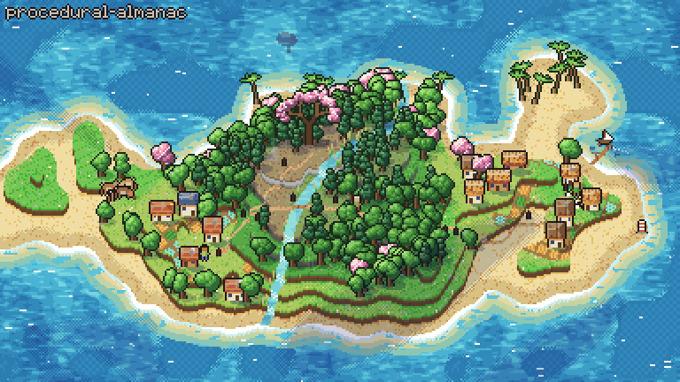
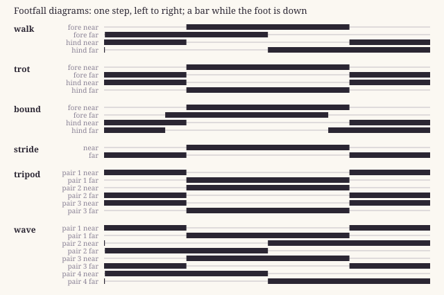

# procedural-almanac

A JavaScript library of procedural generation techniques, with citations for every function.



That island was made with nothing but this library. One [scene](examples/island/scene.js) calls 85 of its functions, and each caption names the ones on screen.

No sprites or image files went into it.

It also [runs in the browser](https://blaiselabs.github.io/procedural-almanac/examples/island/), where any seed grows a different island.

## What's in it

Say you want a leg that reaches for a point. [`twoBoneLimb`](CATALOG.md#twobonelimb) works out where the knee goes, and its catalog entry points to what to read for the math, in this case inverse kinematics and the law of cosines. The entry also lists what its tests check, like "when the point is in reach, the tip lands on it".

There are 162 entries like that, each documenting a single function or class, and they come in two kinds.

77 are established techniques. These cite where they come from, with an intro for background reading (often an encyclopedia article), a source such as a paper, book, standard or published code, or both.

85 are originals, developed specifically for this almanac. Rather than citing an external source, their entries explain what they're for, what inspired them, what they build on and how they work in plain words. [`waterPixel`](CATALOG.md#waterpixel) is a good one to start with.

Together they cite 106 references and are held by 267 checks. Each test is written as a sentence in the catalog, and the test run fails if a sentence isn't a real check, or a check isn't in the catalog.

Not everything here is exotic. The 162 include small helpers like `clamp` and `lerp`, cited the same way as the rest.



The [catalog](CATALOG.md) has every function with its sources and tests. Here's how they're grouped.

| module       | techniques                                                                                                                                                                                                                             |
| ------------ | -------------------------------------------------------------------------------------------------------------------------------------------------------------------------------------------------------------------------------------- |
| `numbers`    | clamp, lerp, smoothstep, wrap, angleDiff                                                                                                                                                                                               |
| `random`     | hash32, fnv1a, hashString, indexRandom, SeededRandom, latticeHash, linearCongruential                                                                                                                                                  |
| `noise`      | latticeRandom, valueNoise, fractalNoise, ridgedNoise, noiseLine, noiseTile                                                                                                                                                             |
| `pixels`     | packRgb, mixPacked, packedHsl, packedToHsl, hueShiftTone, bayerThreshold, ditheredBorder, scalePacked                                                                                                                                  |
| `water`      | waterTime, waterPixel                                                                                                                                                                                                                  |
| `colour`     | hexToRgb, rgbToHex, rgba, mixColour, shade, luma, rgbToHsl, hslToRgb, hueToward, gradeColour                                                                                                                                           |
| `light`      | dayCycle, aerialPerspective, twinkle, hourLight, hourTables, gradeFrame                                                                                                                                                                |
| `land`       | hillLine, islandHeight, levelCut, heightWater, wanderingHeading, chamferDistance, wobbledRing, mountainRise, windingRiver, plotGrid                                                                                                    |
| `scatter`    | scatterAlong, windowLit, blink                                                                                                                                                                                                         |
| `projection` | parallax, turnedProjection, turnedDepth, faceShade, obliqueShear, obliqueToScreen, obliqueToGround                                                                                                                                     |
| `motion`     | flockStep, gridWalk, pulseRise, fleeVector, formationSlot                                                                                                                                                                              |
| `particles`  | particleField, fall, rise, hover, wrapAround                                                                                                                                                                                           |
| `growth`     | branchingTree, swayingChain                                                                                                                                                                                                            |
| `canvas`     | setCanvasMaker, makeCanvas, stampCache                                                                                                                                                                                                 |
| `drawing`    | partPath, fillInArt, drawRecipe, grain, vignette, glowSprite, glowingDisc, lightRays, fogBands, mirrorBelow, puffCloud, inkedLine                                                                                                      |
| `parts`      | tones, drawParts, tracePart, partOutline                                                                                                                                                                                               |
| `display`    | drawList                                                                                                                                                                                                                               |
| `limbs`      | twoBoneLimb, twoBoneLimb3d                                                                                                                                                                                                             |
| `gait`       | footStep, strideRate, gaitTiming                                                                                                                                                                                                       |
| `genes`      | genomeFrom, crossGenomes                                                                                                                                                                                                               |
| `seeds`      | seedOf, seedWords                                                                                                                                                                                                                      |
| `raster`     | ellipseRows, fillEllipse, capsuleSteps, lineCells, polygonRows, ditherEllipse, shadeEllipse, blitSprite, blitSway, outlinePass, cutSprite, drawnBounds                                                                                 |
| `sprites`    | outlineSprite, spriteFromRows, layTemplate, fillBetweenEdges, gridPixels, packSheet, leafCrown, barkTrunk                                                                                                                              |
| `bodies`     | followJoint, dampedSpring, footSwing, footReady, floatHeight, waterlineCut, depthUnderCut, despeckle, staggeredScales, topEdgeShine, furTufts, rimDetail, smoothCurve, bodySpots, bodyPattern, coatColours, resampleList, blendRecords |
| `weather`    | cloudShadows, fogBanks, frontStrength, lightningFlash                                                                                                                                                                                  |
| `paths`      | gridAStar, nearestFreeCell, segmentClear, straightenPath, floodFill, untilSettled                                                                                                                                                      |
| `roofs`      | roofPlan, slopeShade, roofTexel                                                                                                                                                                                                        |
| `relief`     | terraceLevel, wallShade, leafShade, crownRows, silhouetteNormals, crownClumps                                                                                                                                                          |

## Who it's for

- Creative coders and generative artists who want proven techniques, like a limb that steps or legs that keep a gait, without deriving the math again.
- Indie game developers drawing in 2D who want characters and scenery made from code instead of sprite sheets.
- Learners who want to understand a technique. Every entry starts at a plain explanation and leads to the source.
- Programs that build worlds as data, including ones written by language models, since they need functions with clear names and clear documentation.

## What it isn't

It isn't a game engine, a physics library or a 3D renderer, and it doesn't own your render loop. These are functions you call, at your own pace.

## Using it

It isn't on npm yet, so it installs from GitHub.

```sh
npm install github:BlaiseLabs/procedural-almanac
```

The code is plain ES modules with no dependencies and no build step, and it runs in any modern browser and in Node 18 or later.

Here's that leg on a deer. Its leg length and gait are drawn from its kind's ranges, so the same seed gives the same deer every time.

```js
import { SeededRandom, genomeFrom, gaitTiming, footStep, strideRate, twoBoneLimb } from 'procedural-almanac';

// a deer: its leg length and gait drawn from its kind's ranges, the same deer every time from the same seed
const deer = genomeFrom({ leg: [6, 8], gait: ['walk', 'trot'] }, new SeededRandom('deer 1'));
const stride = deer.leg * 0.42,
  lift = deer.leg * 0.22,
  rate = strideRate(stride), // the walk's phase per unit walked, so planted feet end where they landed
  [fore] = gaitTiming(deer.gait); // the phase of each leg, pair by pair

// the near fore leg, when the deer has walked `distance`: its hip, knee and foot
function foreLeg(distance, hip) {
  const step = footStep(distance * rate + fore.near, stride, lift);
  return twoBoneLimb(hip, { x: hip.x + step.x, y: step.y }, deer.leg * 0.54, deer.leg * 0.54, -1);
}
const { knee, foot } = foreLeg(10, { x: 10, y: deer.leg });
```

The `drawing`, `parts` and `display` modules draw on a canvas. In Node that means bringing one, like [@napi-rs/canvas](https://github.com/Brooooooklyn/canvas), and telling the almanac how to make it with `setCanvasMaker`. The rest need no canvas, and the island only uses functions that draw straight into a buffer of pixels.

In a browser without a bundler, one line of import map tells it where the almanac is.

```html
<script type="importmap">
  { "imports": { "procedural-almanac": "./node_modules/procedural-almanac/src/index.js" } }
</script>
```

## The island example

A seed's noise becomes a terraced island, the sea comes in, a river runs down, a forest grows, and villages and roads appear. Then the island goes through a day, a night and a storm before dissolving back into noise.

[`scene.js`](examples/island/scene.js) puts it together from five parts, and each one can be read on its own.

| file         | what it makes                                                                                            |
| ------------ | -------------------------------------------------------------------------------------------------------- |
| `sprites.js` | The palette, and the small pictures drawn from it, like trees, houses, villagers and deer                |
| `world.js`   | The land, the river, villages and fields, roads, and where the trees and the lighthouse stand            |
| `life.js`    | What moves, a step at a time, like walkers, the herd, fish and a whale, gulls, smoke, rain and fireflies |
| `draw.js`    | One frame by day, the land from back to front and then everything standing on it, sorted by depth        |
| `overlay.js` | Clouds, fog, the light of the hour, rain and lightning, the captions, the close-up and the fade          |

The same scene runs in two places. In a browser, [`index.html`](examples/island/index.html) plays it live, with a timeline to drag back to the seed, a box for your own seed, and every function it has called linked to its catalog entry. The [live version](https://blaiselabs.github.io/procedural-almanac/examples/island/) is that same page. To run a local copy, start any static server, because browsers won't load modules from a file.

```sh
python3 -m http.server 8000          # then open http://localhost:8000/examples/island/
```

In Node, [`island.mjs`](examples/island/island.mjs) films it. Making the GIF and MP4 needs ffmpeg.

```sh
node examples/island/island.mjs                         # island.gif and island.mp4 beside the script
node examples/island/island.mjs --still 11 frame.png    # one frame, at 11 seconds
node examples/island/island.mjs --seed amber-vale-7     # another island
```

## How the repo is laid out

| file                     | what it holds                                                                                                                                                           |
| ------------------------ | ----------------------------------------------------------------------------------------------------------------------------------------------------------------------- |
| `src/`                   | The techniques. Each one's doc comment (JSDoc) names its references with `@see`, and a step inside one can cite its own (`[law-of-cosines-wikipedia]`)                  |
| `almanac.json`           | The entries, with each technique's kind and what the catalog says about it                                                                                              |
| `references.json`        | The bibliography, in [CSL-JSON](https://citationstyles.org/), the format reference managers such as Zotero read and write                                               |
| `tests/checks/`          | Every check, one sentence each, the same sentences the entries list, in a file per module. The drawing checks read real pixels (@napi-rs/canvas, a dev dependency only) |
| `tests/run.mjs`          | `npm test`, which runs the checks and then holds the almanac to the rules below                                                                                         |
| `CATALOG.md`, `gallery/` | Written from the above by `npm run docs`                                                                                                                                |
| `examples/`              | Scenes that use only the almanac                                                                                                                                        |

`npm test` fails when any of these is true.

- An export has no entry, or an entry has no export.
- An established entry cites nothing, or an original lacks its purpose, inspiration or plain-words description.
- A reference is named that doesn't exist, or one exists that nothing cites.
- The code's `@see` lines and its entry disagree.
- A test sentence isn't a real check, or a check isn't listed.
- The example in this README doesn't run.
- The catalog or the gallery is out of date.

## Standards it follows

[CSL-JSON](https://citationstyles.org/) for references, [JSDoc](https://jsdoc.app/) for doc comments, [Citation File Format](https://citation-file-format.github.io/) for citing the almanac itself (`CITATION.cff`), [Semantic Versioning](https://semver.org/) and [Keep a Changelog](https://keepachangelog.com/) for releases, and an [SPDX](https://spdx.org/licenses/) license identifier.

## Contributing

A better reference is welcome. That's a change to `references.json` and the entry that cites it.

A new technique is its code, its entry and its checks, and `npm test` says what's missing.

If something here is called original but is really established, that's the most useful correction of all. Show the source and it moves.

## License

[MIT](LICENSE).
